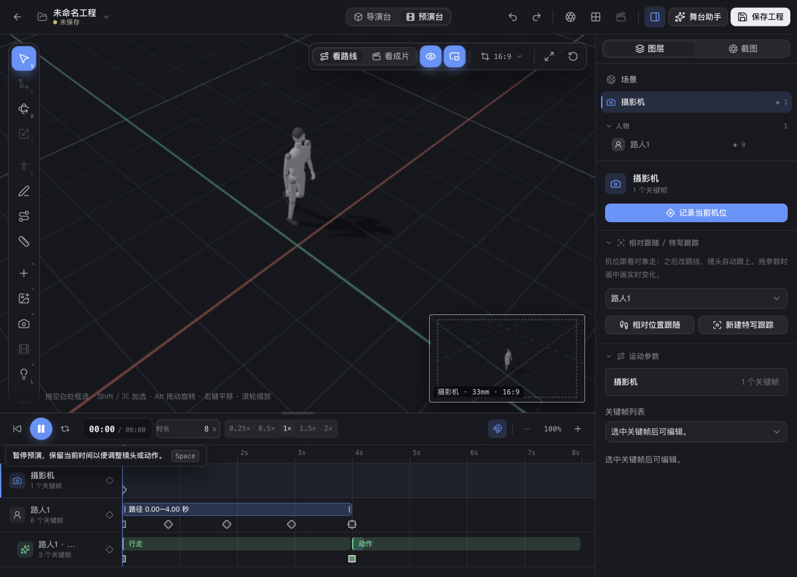

<div align="center">


# Open Storyboard Canvas

**Local-first AI Storyboard & Infinite Canvas Desktop App**  
Connect multi-provider AI models, reference assets, an infinite node canvas, a 3D Director Studio, and scoped AI agents in one local desktop workspace.

[Download Latest](https://github.com/ganbo-gab/open-storyboard-canvas/releases/latest) · [Documentation](docs/) · [Report Issues](https://github.com/ganbo-gab/open-storyboard-canvas/issues)

[简体中文](README.md) | English

<br />



<sub>Demo: Play blocking & trajectories in 3D Previs → capture 4-view shots → inspect in the unified viewer → send back to the node canvas with source edges preserved (recorded 2026-11-05 in a local demo setup).</sub>

</div>

---

## Overview

**Open Storyboard Canvas** is a local-first desktop application for **AI storyboarding** and multimodal creation. It brings scripts, reference assets, image/video/audio generation, an **infinite node canvas**, a **3D Director Studio & Previs stage**, and built-in **AI agents** together in one workflow.

Built for AI filmmakers, comic artists, and storyboard creators, it lets you test models quickly in a generation workbench, compose reusable node workflows on an infinite canvas, block cameras and characters in 3D, and keep your projects and assets stored locally on your machine without vendor lock-in.

> Current source version: **v0.2.2** (**macOS** & **Windows**). The capabilities below reflect the current source tree; check [GitHub Releases](https://github.com/ganbo-gab/open-storyboard-canvas/releases) for exact release package contents.

---

## Core Features

### 1. Generation Workbench
- **Unified Multimodal Sessions**: Generate images, videos, audio, and text chats in one workbench with searchable, pinnable, renameable session history linked to canvas projects.
- **Streamlined Composer**: Use `@` to reference assets, `/` to pick presets, drag/paste reference images, expand the editor, and collapse the composer while reading history.
- **Provider-Driven Parameters & Size Mapping**: Aspect ratio, resolution, duration, batch count, and start/end frame slots follow each channel's schema. Toggle between pixel dimensions and aspect-ratio + resolution views without breaking underlying API values.
- **Traceable History & Recovery**: Inspect multi-output batches in a unified viewer, reuse outputs as references, or send them to any canvas. Every submission records its exact model, parameters, prompt, and upstream task ID, clearly separating original task polling from re-generation.

### 2. Infinite Node Canvas
- **Node-Based Storyboarding Workflow**: Connect text, image, video, audio, generation, storyboard, panorama, Director Studio, and tag-group nodes into editable workflows.
- **Presets, Image Actions & Floating Camera Controls**: Apply prompt presets via `/` directly inside generation nodes, pick explicit reference roles on multi-image inputs, and use a resizable floating camera panel (body, lens, focal length, aperture, local presets) that appends camera prompts independently of canvas zoom.
- **Non-Destructive Asset Editing**: Crop, annotate, rotate, or flip images and trim/extract audio or video frames locally—saving derived copies with source edges intact.
- **Customizable Controls & Large-Canvas Optimization**: Configure 9 mouse button actions (left/middle/right click, double-click, drag) plus scroll behavior, customize toolbars, copy nodes via the system clipboard, and undo/redo graph edits. Large graphs use spatial indexing, viewport culling, and fallback-safe vector edge caching.

### 3. 3D Director Studio & Previs
- **3D Blocking & Timeline**: Arrange characters, props, lights, and cameras in 3D scenes or panoramic backdrops; draw ground trajectories and edit keyframes, poses, animations, and camera tracks on a timeline.
- **Camera Modes & 4-View Capture**: Switch between follow-target, look-at point, and free orbit cameras; capture single or 4-view shots at any timestamp and send them straight back to the node canvas with source links preserved.
- **3D Assets & Recording**: Import GLB/glTF models, set panorama backdrops, record stage playback, and invoke configured image-to-3D models.
- **Stage Agent Previs (Experimental)**: Let the Stage Agent assemble primitive geometry, characters, trajectories, and camera tracks from text or references into an editable 3D stage project.

### 4. Multi-Scope AI Agents & Local Knowledge Base
- **Three Scoped Agents**:
  - **Home Creative Assistant**: Drafts scripts/storyboards, previews before placing on canvas, searches assets, triggers workbench generation, and helps prepare channel configs.
  - **Canvas Agent**: Inspects the active project and selection, creates/edits nodes and edges, runs generations, checks sanitized diagnostics, and supports revision-guarded undo.
  - **Stage Assistant**: Reads scene objects, cameras, paths, and animations; previews and applies stage plans, captures 4-views, and records.
- **Explicit Approval & Execution Modes**: Choose between **Ask for Confirmation**, **Assisted Execution**, and **Full Execution**. None of the modes expose arbitrary system shell or filesystem access.
- **Runtime Guardrails**: Shared 96 tool-call / 30-minute turn limit, up to 3 automatic retries on transient rate limits/server errors before output begins, receipt-preserving resume after failures, and no blind replay of ambiguous paid requests.
- **Protocol & Knowledge Support**: Adapts to Chat Completions, Responses, Anthropic Messages, and Gemini tool protocols per channel declaration. Mount any local Markdown folder (Obsidian-compatible) as a searchable knowledge base.

### 5. Multi-Provider Channels & Model Management
- **Single-Model & Aggregator Support**: Manage single-model endpoints, multi-model providers, and cross-category relays in **My Channels**, and filter all connected models in **Model Plaza** by modality and schema.
- **Three Onboarding Paths**: Start from protocol templates, let a configured LLM parse API documentation into a draft config, or paste external config JSON. Free model-list fetching is separated from billable test runs, with batch **Unified Config** application.
- **Ecosystem Integrations**: Built-in **ComfyUI** multi-workflow connection & AI binding suggestions, dedicated **Dreamina CLI** integration, unified `audio.generate` channels, and user-configured custom image hosts.
- **Isolated Credential Storage**: API keys are stored separately from regular config via **macOS Keychain** or **Windows Credential Manager**, and are omitted from standard exports and request previews.

---

## Quick Start

### Desktop Installation

Download the installer from [GitHub Releases](https://github.com/ganbo-gab/open-storyboard-canvas/releases/latest) (GitHub Tag pages only contain source archives):

- **Windows**: `open-storyboard-canvas_<version>_x64-setup.exe` (requires [Microsoft Edge WebView2 Runtime](https://developer.microsoft.com/microsoft-edge/webview2/) if not already installed).
- **macOS**: `open-storyboard-canvas_<version>_universal.dmg` (supports Apple Silicon & Intel; currently unsigned/unnotarized—allow via *System Settings → Privacy & Security* or right-click → *Open* on first launch).

### Local Development

**Prerequisites:**
- Node.js `22.22.2+` (22 LTS), `24.15+` (24 LTS), or `26+`
- Rust `stable`
- Tauri 2 platform dependencies (Xcode Command Line Tools on macOS; Visual Studio C++ Build Tools & WebView2 on Windows)

```bash
git clone https://github.com/ganbo-gab/open-storyboard-canvas.git
cd open-storyboard-canvas
npm install

# Frontend dev server
npm run dev

# Tauri 2 desktop app
npm run tauri dev
```

---

## Tech Stack & Supported Platforms

| Layer | Technologies |
| --- | --- |
| Desktop Shell | **Tauri 2** |
| Frontend | **React 19**, **TypeScript**, **Tailwind CSS**, **Zustand** |
| Canvas & 3D | **React Flow (`@xyflow/react`)**, **Konva**, **Three.js**, **Photo Sphere Viewer** |
| Native & Storage | **Rust**, **SQLite (`rusqlite`)**, OS credential store (`keyring`) |
| Platforms | **macOS** (Apple Silicon & Intel, macOS 11.0+), **Windows** (x64 + WebView2) |

---

## Notes & Known Limitations

- **Verification Scope**: As of `2026-11-09`, frontend automated checks pass across 350 files / 3,208 tests alongside Rust contract tests and controlled agent/task-health regressions. Controlled tests do not guarantee every third-party relay or upstream provider works identically. Large-canvas zoom has been measured on native macOS (initial low-zoom long frames still occur in 1,000-node scenes; constant 60 fps is not guaranteed); Windows native interaction still requires broader real-device verification.
- **Experimental Features**: Built-in Agents and the Stage Agent remain under active iteration. The 3D stage currently uses a single V1 spatial track per object and primitive/imported asset composition rather than full mesh modeling.
- **macOS Code Signing**: Releases `v0.2.0`–`v0.2.2` use ad-hoc signing, so macOS Keychain may prompt again per credential after upgrading (see [docs/release/macos-signing.md](docs/release/macos-signing.md)).
- **Data, Privacy & Billing**: Projects and media references stay local by default with no cloud sync account. Generation prompts and references are sent only to the providers or local tools you configure; billing, moderation, and data retention follow each provider's terms.

---

## Changelog

See [GitHub Releases](https://github.com/ganbo-gab/open-storyboard-canvas/releases) for full release notes:

- **v0.2.2** — Unified model configuration across live requests, agent queries, and history diagnostics; accurate aspect ratios on pending placeholders; single-row composer layout polish; fixed credential idle false-lock and sticky transient errors; removed ~1,360 lines of dead code. ([Chinese notes](docs/releases/v0.2.2.md))
- **v0.2.1** — Independent configuration for 9 mouse click/double-click/drag bindings plus scroll wheel with recommended and classic presets; fixed hand-tool edit lock and selection/menu conflicts. ([Chinese notes](docs/releases/v0.2.1.md))
- **v0.2.0** — Major modular architecture refactor across the canvas engine, unified channels, generation/task recovery, agent execution, credential isolation, and asset management. ([Chinese notes](docs/releases/v0.2.0.md))

---

## Contributing, License & Security

- **Contributing**: Bug reports, provider adapters, performance improvements, and docs PRs are welcome—please read [CONTRIBUTING.md](CONTRIBUTING.md) first and never share API keys, system passwords, or private assets in issues.
- **Upstream Attribution & License**: Continued development fork of [henjicc/Storyboard-Copilot](https://github.com/henjicc/Storyboard-Copilot) by **henjicc / 痕继痕迹**, with written chat authorization ([record](docs/legal/upstream-author-authorization-2026-05-31.jpg)) on condition that original author attribution and repository link are retained. See [NOTICE](NOTICE). New additions are licensed under the [MIT License](LICENSE).
- **Security**: See [SECURITY.md](SECURITY.md) for vulnerability reporting and credential hygiene guidelines.
