<div align="center">


# Open Storyboard Canvas / 开源画布

把模型、素材、分镜、Agent 与三维舞台连接起来的本地桌面创作工具。

[下载最新版](https://github.com/ganbo-gab/open-storyboard-canvas/releases/latest) · [使用与开发文档](docs/) · [加入 QQ 群](#交流与反馈) · [报告问题](https://github.com/ganbo-gab/open-storyboard-canvas/issues)

</div>

## ❤️ 友情赞助

<table>

<tr>
<td width="180"><a href="https://torchai.ai"></a></td>
<td>感谢 TorchAI.ai 赞助了本项目！<a href="https://torchai.ai">TorchAI.ai</a> 核心主营 GPT 号池与 Claude 号池，自主搭建 Pro / Max 账户池，全力保障稳定流畅的 GPT 调用体验；无掺假、无套壳，只做真实、稳定、高性价比线路。企业对接倍率更低，支持 10000 RPM，可测模型。点击<a href="https://torchai.ai">此链接</a>了解更多。</td>
</tr>

</table>

## 项目简介

Open Storyboard Canvas 是面向桌面的本地 AI 创作工作台，把剧本、参考素材、图像、视频、音频、分镜和三维舞台放进同一个工作流。

你可以在生成工作台快速试模型，也可以把结果送到节点画布继续组合；需要安排人物走位和镜头时，进入导演台与预演台。首页、画布和舞台各有自己的 Agent 会话，帮助整理方案、操作工具和跟进任务。

当前版本为 **0.2.1**（画布鼠标自定义与交互优化，部分 Agent 功能仍在测试迭代），基于 Tauri 2、React、TypeScript 与 Rust，面向 macOS 和 Windows。下文介绍当前源码的界面与能力；发布安装包是否包含这些改动，请以 Releases 对应版本为准。

## v0.2.1 交互优化

鼠标左、中、右键的单击、双击与拖动共九项现在可独立配置，滚轮另选；提供推荐与传统预设。修复抓手锁住节点编辑、双击空白创建失效、框选与菜单冲突，并兼容旧鼠标配置和设置备份。升级保留已有操作习惯，想使用左拖平移／右拖框选，可在「设置 → 键位设置」选择推荐预设并保存。详见 [中文更新说明](docs/releases/v0.2.1.md)。

## v0.2.0 架构更新

本次围绕画布引擎、统一渠道、生成与任务恢复、Agent 执行、凭据和素材管理做了大规模模块拆分与规范化。界面与 Agent 复用图编辑和生成服务，减少重复实现；类型校验与回归测试覆盖关键边界。舞台等历史模块仍有待继续整理，重构不代表所有技术债和未知问题已消失。与 v0.1.27 的逐项对比见 [中文更新说明](docs/releases/v0.2.0.md)。

## 主要能力

### 生成工作台：从一句话到可复用的素材

- 图片、视频、音频与文本对话集中在一个工作台，按创作会话保存历史，支持搜索、置顶、改名及关联画布项目。
- 输入区支持 `@` 引用素材、`/` 选择预设、拖入或粘贴参考图、展开编辑、素材排序及局部撤销。
- 模型支持的比例、分辨率、时长、数量、首尾帧等模式由渠道声明决定。切换模式后展示对应的参数与输入槽位。
- 尺寸可以保留 `1024×1024` 的像素选项，也可显示为“比例 + 分辨率”。切换显示方式仍使用渠道原来声明的接口值，只提供有效组合；显示名称、选项、默认值与控件样式均可继续编辑。
- 同一次生成的多个结果完整展示；可打开统一查看器、下载、用作参考、重新编辑，或发送到指定画布。
- 阅读历史时输入区可收起；新结果到达时可回到最新内容，不强行打断阅读。

### 渠道与模型：单模型和综合中转站都能管理

- **我的渠道**展示每个连接的模型数量、覆盖类别、凭据与测试状态，区分单模型、同类多模型和跨类别渠道。
- **模型广场**把已接入模型放在一起，按文本、图片、视频、音频、3D、渠道及配置状态筛选，支持卡片与列表视图。
- 从协议模板开始，先填 URL 与 API Key，再获取或手填模型 ID、勾选需要接入的模型。系统提供类别建议，用户可以修正，并为每个模型确认实际请求协议；模板里的模型名只作为帮助示例。
- 支持模板、让已配置的 AI 阅读接口文档、粘贴外部 AI 生成的配置三种接入方式。保存前可以核对模型、模式、参数和请求预览。
- 免费读取模型列表与可能计费的试运行分开；读取名称后仍需选择对应接口配置。保存、浏览和切换模型不会自动发起生成。
- ComfyUI 支持连接、多工作流、依赖预检及任务查询，AI 可根据结构建议输入/输出绑定；自定义图床可粘贴公开接口文档，由 AI 生成未启用的配置草稿。首页、画布与舞台 Agent 均可预览配置，再按当前执行模式应用；配置分析本身不会运行工作流或上传文件。
- 已知模型 ID 可自动补全官方能力建议，显示资料来源，保留用户手填限制。预设不代表中转渠道实测可用，也不会额外接入模型。
- Dreamina（即梦）CLI 保留专用接入与原任务查询。
- **音频统一通过渠道接入。** 旧豆包本地 TTS、VoxCPM 适配器和独立音频设置已移除；已有音频素材与历史保留，旧模型不会静默替换成其他渠道。

### 节点画布：连接素材、提示词和结果

- 文本、图片、视频、音频、生成、分镜、全景、导演台和标签组等节点，可以连接成持续编辑的工作流。
- 生成节点输入区直接选择“预设”，复用自定义预设和收藏的提示词，追加或替换成可编辑正文；输入 `/` 可搜索功能。图片节点连接参考图后可选择图片功能，多图时明确操作对象，再编辑提示词并生成。
- 摄像机控制使用独立、可调整大小的弹窗，支持机身、镜头、焦距、光圈与本机预设。开启后在生成时追加摄影提示词，界面不随画布缩放。
- 引用缩略图右上角可移除引用并断开当前节点连线，保留原素材，同步更新 `@` 编号与模型输入槽位。节点复制写入系统剪贴板，快捷键和右键粘贴按最新复制内容处理；在外部粘贴节点会显示节点数据文本，跨设备仍需迁移本机素材文件。
- 节点标题菜单与右键使用同一组操作；多选支持排列、连接、合并分镜、下载、保存素材等动作。
- 多结果支持设主项、浏览整批、展开与拆分。素材库和画布节点树可用于定位、重命名和复用。
- 图像变换、视频截帧/裁剪/分离音轨、音频截取等操作使用统一媒体处理与资产持久化路径。
- 图编辑支持撤销/重做。大画布采用空间索引、可见区域裁剪和按需订阅，性能边界以实际场景与平台为准。

### 资产内容编辑：保留原件，保存副本

- 资产卡片和查看器可进入“编辑内容”。图片支持裁剪、标注、旋转、翻转及编辑步骤撤销/重做；文本可编辑正文、名称和提示词/说明。音视频复用本地截取、裁剪、音轨等媒体工具，能力取决于平台编解码支持。
- 编辑结果保存为新资产，保留父素材及操作来源。画布图片使用同一编辑器，保存后在原图旁生成衍生节点与来源连线，可一步撤销该图操作。

### 导演台与预演台：构图、走位、镜头和取景

- 在三维场景或全景背景中安排人物、道具、灯光与机位，支持对象隐藏/锁定、多选、变换、姿势与动作。
- 在地面画路线，在时间轴调整关键帧、动作与机位轨道；可修改路线时长、开合环、吸附和预览。
- 摄影机支持跟随对象、看向固定点和自由旋转。选中机位后双击人物设为跟踪目标，拖动视线端点改为定点，旋转环调整自由朝向。
- 当前画面或指定时刻可拍摄单张/四视图，打开查看器检查后送回画布，保留来源连线并支持撤销。
- 支持录制、全景背景、GLB/glTF 模型导入，以及按已配置模型能力使用图生 3D。真实模型质量与编解码能力取决于供应商及运行平台。

### 从文字或参考素材到可编辑的舞台预演（实验中）

舞台 Agent 可以组合基础形体搭建空间、放置人物和道具，再安排人物走位、动作、摄影机路径与时间轴。结果保留为可继续编辑的舞台对象和轨道，方便一边播放一边调整构图，而不只得到一段文字方案。

下面是 **2026-11-07 用户实际测试截图**：建筑场景、双人相遇、约 15 秒时间轴与多段镜头编排。截图展示这次测试中呈现的结果，不代表每次请求都能达到相同效果。

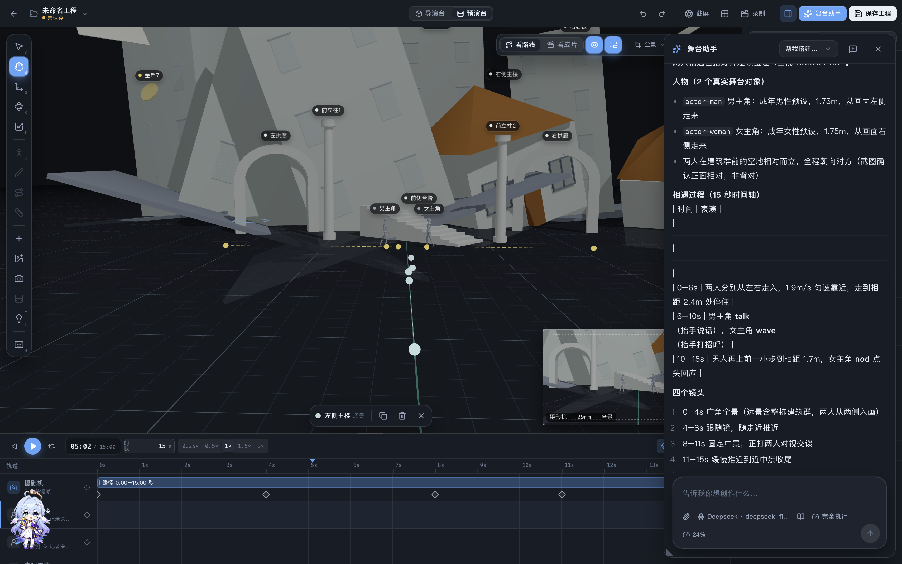

**目前仍在测试迭代，不能保证百分百还原参考图、准确执行所有要求或每次成功。** 建筑细节、人物动作、空间关系和镜头节奏可能需要手动修正。当前主要通过基础形体与已有/导入资产组合场景，不等同于任意精细网格建模。欢迎带着复现步骤和期望效果反馈问题，帮助我们继续完善。

### 三个作用域的 Agent

| 会话 | 可调用的主要能力 |
| --- | --- |
| 首页创作助手 | 整理剧本和分镜方案，预览后铺到画布；检索素材；发起工作台生成并查询原任务；辅助准备渠道配置 |
| 画布 Agent | 读取当前项目与选中内容，创建/编辑节点和连线，运行生成，查看任务与脱敏诊断，执行允许范围内的配置修改 |
| 舞台助手 | 查询对象、机位、轨迹和动作，预演并应用舞台方案，取景/四视图与录制 |

- 支持流式回复、停止、模型选择、工具步骤、审批卡和调用详情；离开页面或收起面板不会自动丢弃正在运行或待审批的会话。
- 首页、画布和舞台内置 Agent 共享运行保护：单回合最多 **96 次工具调用、30 分钟**，审批等待计入总时限；达到限制后停止并保留已完成结果。同一会话不允许并发推进，重复审批不会重复执行同一操作。
- 服务明确返回临时限流或可恢复的服务端错误，且尚未输出响应时，最多自动重试 **3 次**，界面显示重连进度。鉴权、余额不足、参数错误、已经开始输出或受理情况不明的断线不会盲目重放；模型重连也不会重新执行已有工具结果。
- 失败续接会保留会话和已记录的工具回执，缺失结果明确标记为未确认。首页和舞台可点“继续未完成的部分”，画布可继续发送指令；先检查已有场景与原任务，再做剩余步骤。这不保证模型每次判断正确，也不代表关闭软件后任务能在后台持续运行。
- 错误默认显示简短摘要，继续执行后的旧工具错误收成一行，点击可展开并复制已保留的脱敏详情。本地存储满、模型限流与明确账单限制分开显示，不根据“配额”字样断言账号没钱。Agent 历史与恢复记录采用无损压缩，幂等记录使用摘要减少重复数据；不删除对话或工具结果来腾空间。
- 提供三种执行模式：**请求确认**直接读取，编辑、生成、配置和删除前确认；**辅助执行**自动完成普通编辑，生成、外部提交、配置和删除仍需确认；**完全执行**在启用时明确授权应用内工具执行，包括可能计费的生成、配置和删除。三种模式都保留预算、项目修订与任务幂等边界，不开放任意系统文件或命令，不重提受理情况不明的生成请求。
- 按渠道声明适配 Chat Completions、Responses、Anthropic Messages 与 Gemini；保留工具续聊所需的供应商状态，截断的工具回复不执行。用量可展示上游返回的缓存命中数据；实际缓存率取决于供应商与任务。
- 缺少必要信息时显示可选择或补充文字的询问卡。所有模式都等待实际回答；取消不会当作同意。未选生成模型时会询问，画布不会自行挑选目录第一项；选择卡中的有效模型后沿用该精确模型。生成参数确认、短句“生成吧”和重开后的工具审批会保留原任务所选模型，避免再次退回没有执行工具的普通对话。
- “上下文”展示上一条实际请求中的系统提示、技能、工具、对话与附件占用：总量优先使用供应商用量，分项为本地估算，草稿单列。切换模型后隐藏旧模型占比；未声明上下文上限时显示未知。统计只保存数量与会话/模型标识，不保存请求正文；统计存储失败不会阻断调用。
- 知识库可使用任意本地 Markdown 文件夹，Obsidian 为可选兼容来源；可检索、读取和按工具权限编辑笔记。画布会话按知识意图或所选技能启用相关工具。
- **画布/舞台的图编辑可以撤销。** 已提交的付费请求、下载、知识库文件写入不会被画布撤销取消；配置修改使用自己的回滚机制。画布 Agent 提供受项目与修订检查保护的回执/整轮撤销，首页和舞台聊天面板不具有相同的整轮撤回按钮。

### 可追溯的历史与结果恢复

- 工作台、画布节点、生成历史与运行日志使用统一详情，展示当时保留的提示词、模型、参数、参考数量、原任务 ID、结果与错误。
- 同一节点的不同提交分别保留，不会拿当前参数覆盖旧记录。没有保存的字段明确显示“未记录”。
- 任务中心分开显示“进行中”和“待处理”：凭据未授权、查询暂停、结果缺失和提交未知不再算作运行中；连续 6 小时未观察到进展时暂停本地等待，保留原任务供核对，不据此判定上游失败。暂停项显示最后更新时间，手动恢复后只查询原任务。
- 原任务查询与“再次生成”区分：查询和取回使用原任务句柄；提交结果未知时，不自动重发可能计费的请求。
- 恢复需要保留有效的任务 ID、结果地址或本地资产。远程结果过期、记录已删除或从未保存的返回内容，无法凭空重建。

画布节点工具栏默认只显示少量常用操作，其他功能放入“更多”；左侧把文字、图片、视频、音频创作入口分组。两个工具栏都可以调整显示项、顺序和数量。主导航、工作台历史、设置导航与知识目录支持拖动分隔线调宽、双击复位并记住尺寸；Agent 与编辑面板支持调整尺寸，可在外观设置锁定；短菜单点击外部关闭，复杂编辑窗保留到明确关闭。

知识库存放剧本、世界观、创作规则与参考出处；资产库存放媒体文件和生成结果。当前“保存到知识库”仍可复制附件以保持目录可移植，跨库去重尚未实施。

## 操作演示

### 调整工作区宽度与项目归属

拖动创作记录与内容之间的分隔线，双击恢复默认；项目归属菜单说明记录分组和后续资产的去向。下面为本轮生产版本实际操作截图序列生成的 GIF。

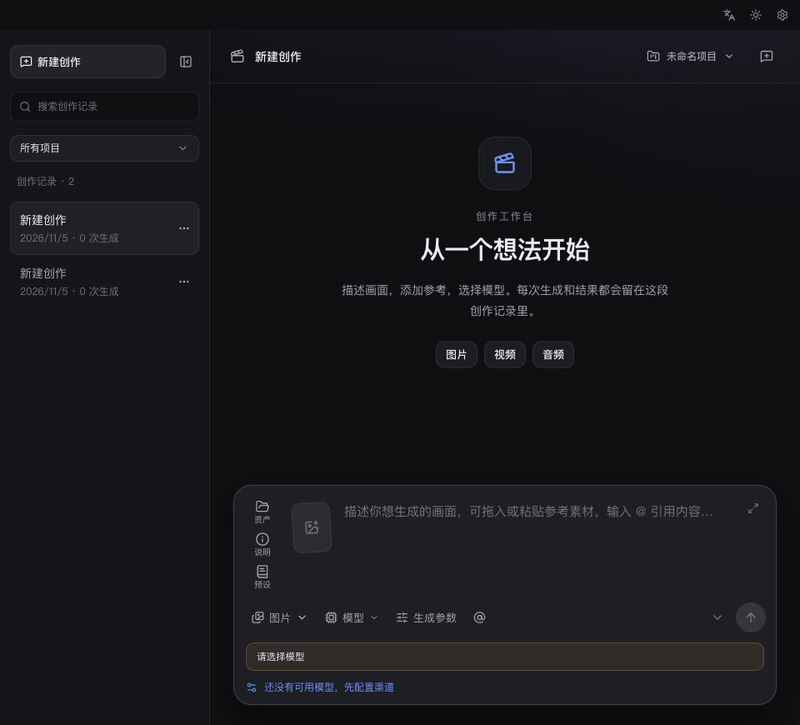


渠道参数现在可直接调整显示名称、选项、默认值、顺序和控件样式，并预览工作台效果。`@` 引用支持在光标处筛选素材、缩略图预览和键盘选择。macOS 拒绝凭据授权后会暂停原任务，明确重新授权后才继续查询。

以下 GIF 录制于 **2026-11-05，0.2.0-next.1**，展示桌面界面的实际操作。前四段为本轮反馈前的录制，部分输入区和工具布局已有调整；后面的画布工具演示录自修复版本。渠道与生成结果使用本地演示配置、测试素材，Agent 使用本地模拟回复和工具请求；不代表真实供应商的生成质量、响应速度或连接测试结果。

### 渠道与模型：筛选、切换视图、查看能力

从“我的渠道”进入模型广场，按类别筛选，切换列表与卡片，展开模型支持的参考输入和参数。

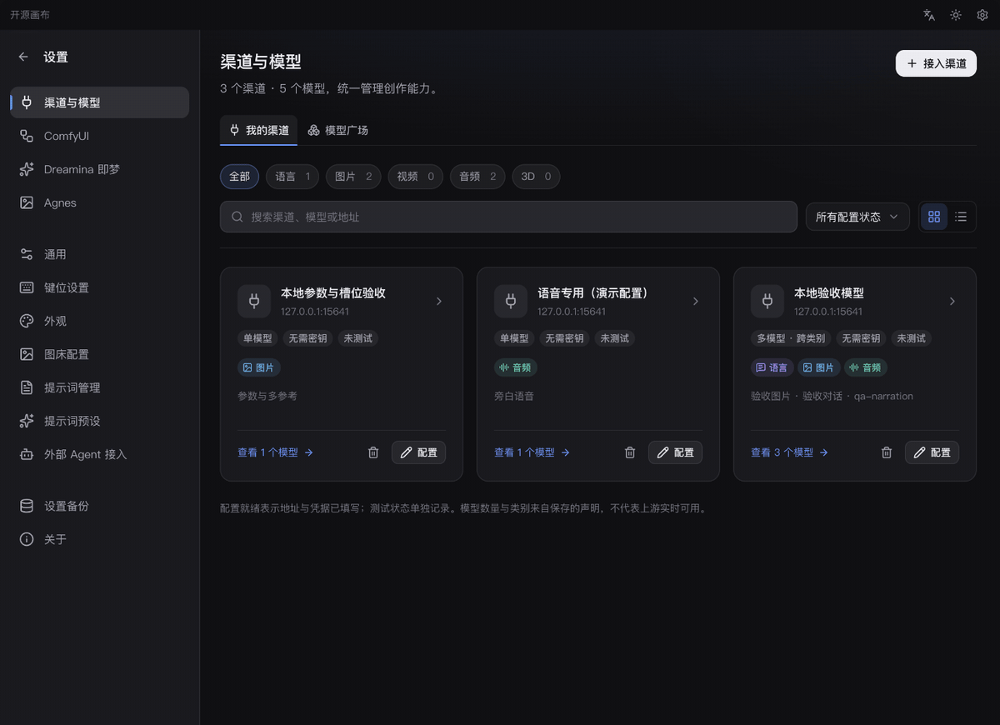

### 生成工作台：输入、生成、追溯这次提交

输入提示词，核对比例和数量，查看多个结果，再打开详细信息核对当次提交的模型、参数与提示词。

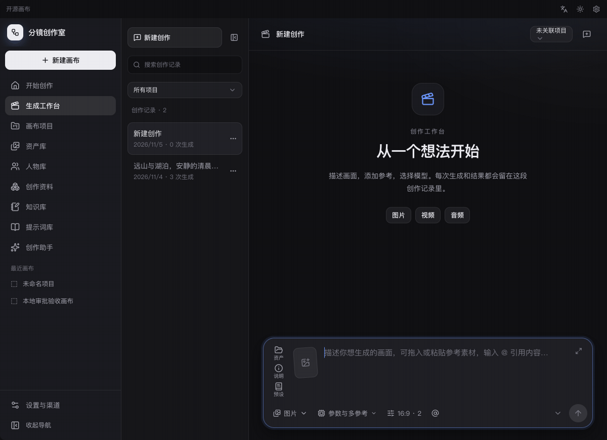

### Agent：看清操作，再批准

提出创建画布的请求，查看助手准备执行的操作和审批卡，再决定批准或拒绝。这段演示停在待审批状态；模型请求由本地模拟接口提供，审批界面使用应用的实际流程。

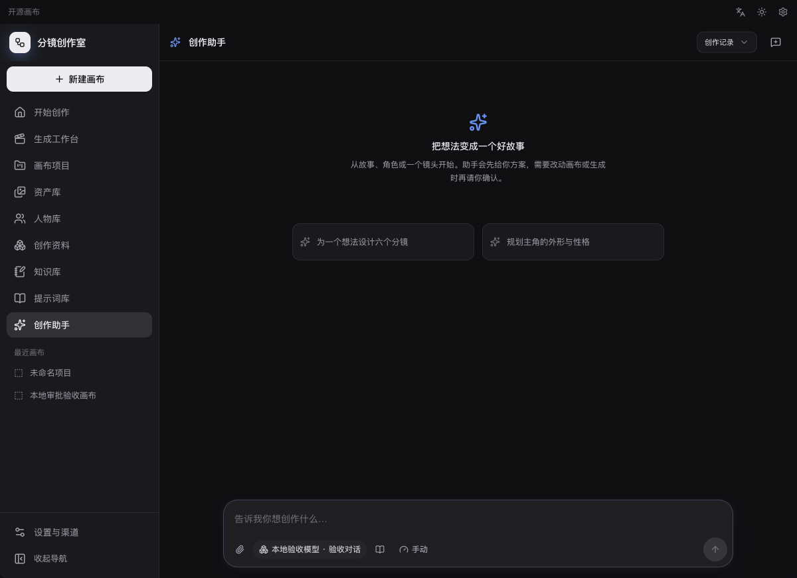

### 舞台到画布：播放、四视图、素材回流

播放人物路线与动作，拍摄四视图，在查看器中切换角度，再将四张图送回画布，保留与导演台节点的来源连线。

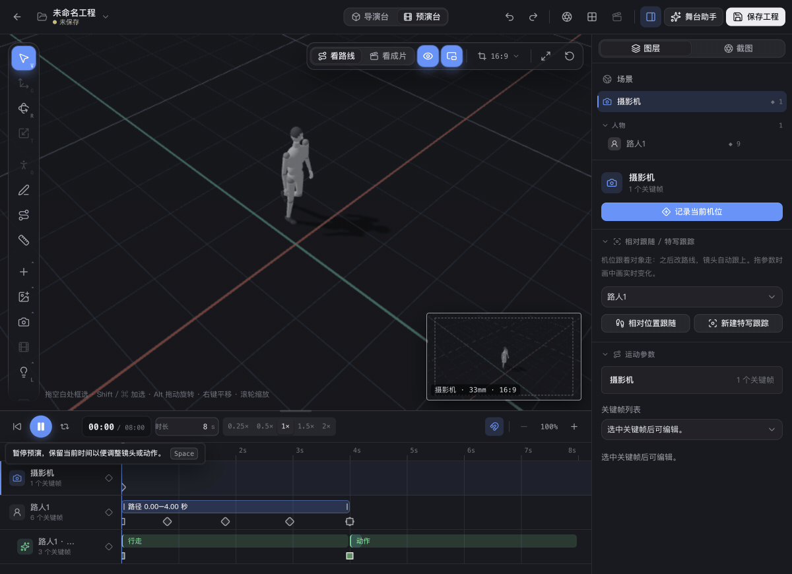

### 画布工具：短菜单、更多与自定义

打开编辑菜单，进入“更多”调整常驻数量，再展开文字、图像、视频、音频分组。此段由修复版本的真实操作截图按顺序制作，使用项目自带示例图片；静止步骤适当延长以便阅读。

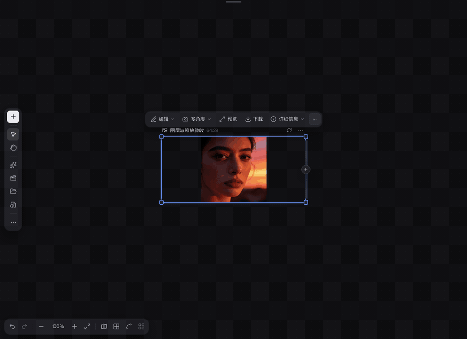

<details>
<summary>展开查看静态界面截图</summary>

以下截图使用同一套本地演示配置与测试素材，可停留查看界面细节。

| 界面 | 预览 |
| --- | --- |
| 渠道管理：单模型与跨类别渠道 | 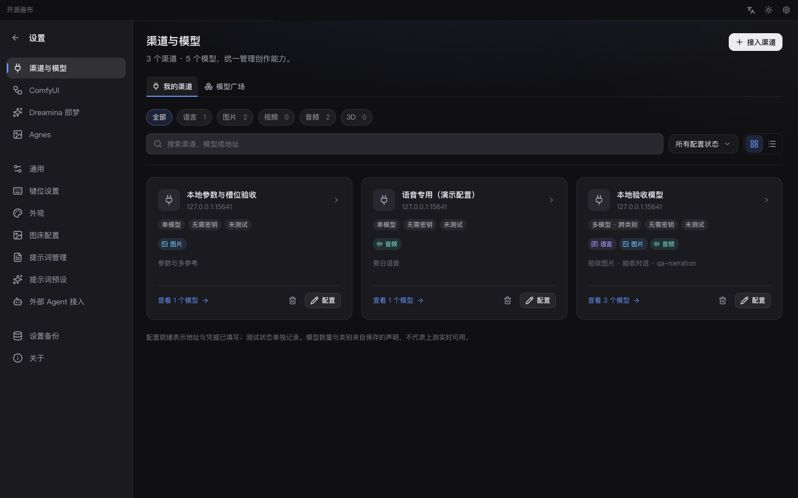 |
| 模型广场：跨渠道筛选和查看能力 | 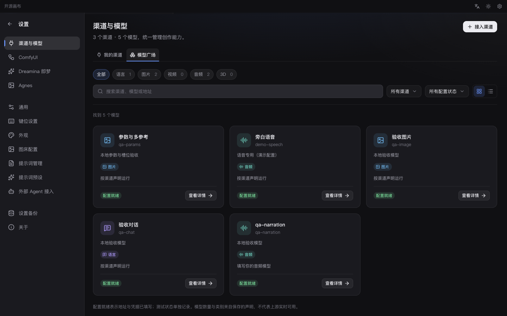 |
| 生成工作台：历史、结果与共享输入区 | 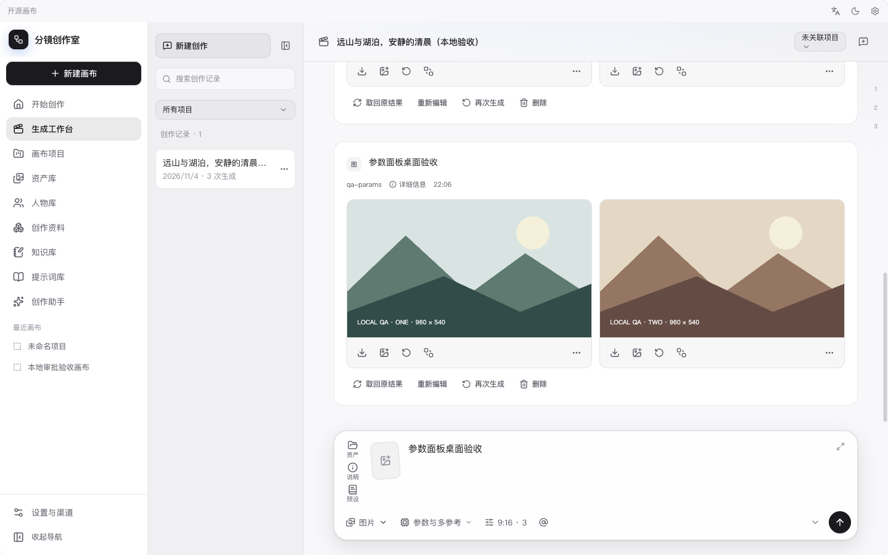 |
| Agent：持续会话与共享输入 | 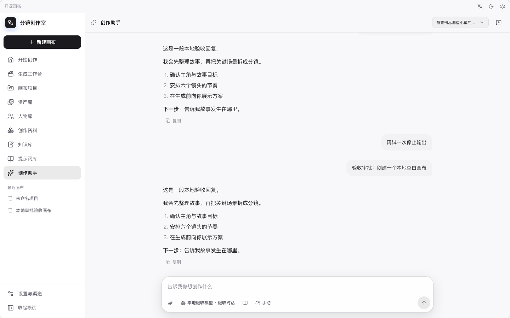 |
| 预演台：路线、机位与时间轴 | 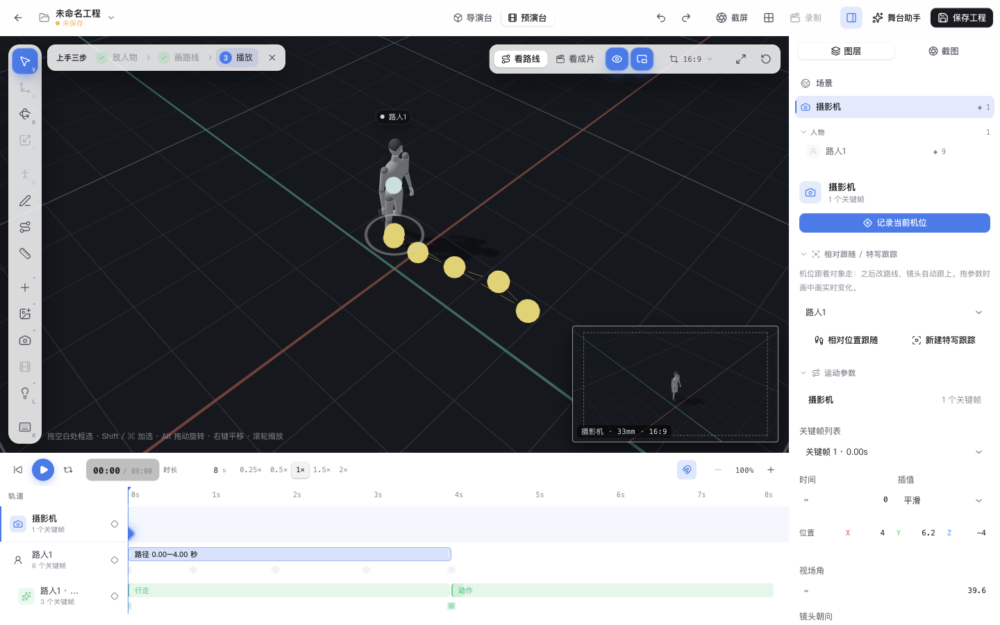 |
| 四视图结果与统一媒体查看器 | 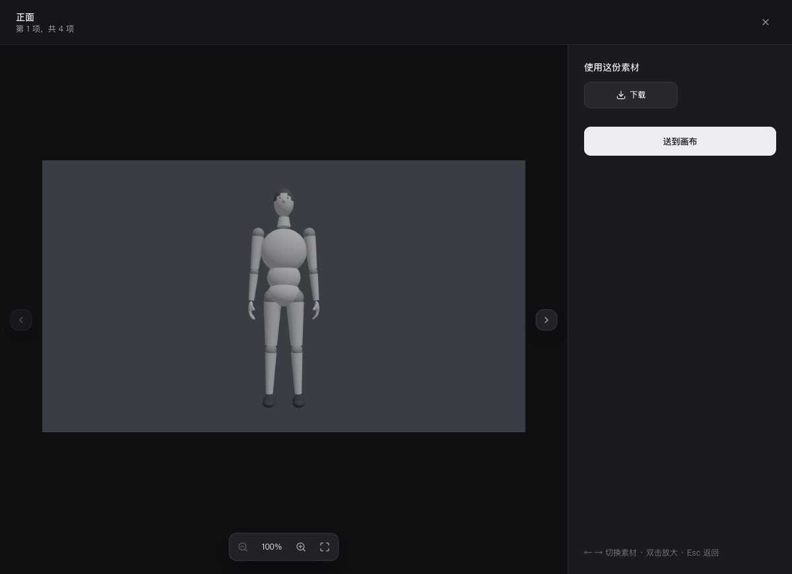 |

</details>


## 下载与安装

前往 [GitHub Releases](https://github.com/ganbo-gab/open-storyboard-canvas/releases/latest)：

- Windows：下载 `open-storyboard-canvas_<版本>_x64-setup.exe`。
- macOS：下载 `open-storyboard-canvas_<版本>_universal.dmg`，同时支持 Apple Silicon 与 Intel Mac。

安装提醒：

- GitHub Tag 页面只有源码压缩包，桌面安装包请从 Releases 页面下载。
- macOS 包目前没有 Apple Developer ID 签名和公证。首次打开若被拦截，请在“系统设置 → 隐私与安全性”中允许打开，或右键应用后选择“打开”。
- macOS 下载时请核对架构：`aarch64` 适用于 Apple Silicon，`x64` 适用于 Intel，`universal` 兼容两者；以该次发布提供的文件为准。
- Windows 若提示缺少 WebView，请安装 [Microsoft Edge WebView2 Runtime](https://developer.microsoft.com/microsoft-edge/webview2/) 后重试。
- 请只从本仓库 Releases 下载，并核对版本号与文件名。

### macOS 为什么会请求访问钥匙串？

API Key 等凭据与普通渠道配置分开保存，macOS 使用系统钥匙串。首次调用需要凭据的接口、重新授权，或更换构建后，系统可能询问是否允许应用读取已保存的凭据；浏览渠道列表本身不应反复要求解锁。

确认弹窗请求者是你刚打开的本应用后，在 **macOS 系统弹窗**中输入登录钥匙串密码（通常与 Mac 登录密码相同）。只点“允许”可能只授权本次访问；如果信任这个安装版本，可以选择“始终允许”。密码由系统处理，不要填进渠道 API Key 栏或发到聊天、Issue 中。当前未公证的预览包在更新后，应用签名身份可能变化，系统也可能再次要求授权。

点“拒绝”后，相关调用会暂停，并提示重新授权。请在应用的凭据恢复入口明确重试授权，再查询原任务；如果供应商已受理生成，使用“查询/恢复”取回，避免再点一次生成。持续弹窗、始终允许后仍失败，或保存的渠道消失，都欢迎作为 Bug 反馈；不要通过删除全部渠道或清空钥匙串来尝试解决。

## 首次使用

1. 打开 **设置与渠道 → 渠道与模型 → 接入渠道**。选择接口模板，填写 URL 与 API Key，读取或手填模型并勾选需要接入的项；核对类型、请求协议和高级参数后保存。也可提供接口文档或配置 JSON。
2. 回到“我的渠道”检查连接，再到“模型广场”查看它支持哪些输入、模式和参数。“配置就绪”不等于已通过上游测试；可先免费读取模型列表，再按需明确批准一次试运行。
3. 在模型详情点“用它创作”，或进入“生成工作台”选择模型。写提示词、添加参考素材、选择参数，再点击生成。不同类别的参考素材必须符合当前模式的槽位声明。
4. 打开结果查看、下载或用作下一轮参考；需要组合工作流时，发送到画布。选中生成节点后使用浮动输入区，进入导演台/预演台安排空间和镜头。
5. 使用创作助手时先选择支持工具调用的文本模型。检查方案、审批和工具回执；遇到异常先查看原任务详情与日志。“停止等待”不等于取消上游生成。

### 渠道接入说明

- **只接一个模型**：填写连接信息后，获取或手填模型 ID，只勾选需要的一项，再审阅保存。
- **同渠道多个同类模型**：在渠道设置中添加模型，明确沿用已有模型的请求配置；可免费读取上游名称后批量选择。
- **统一配置**：在渠道的“模型管理 → 统一配置”中选择来源、参数和目标模型/模式，预览后批量应用。默认保留目标仍有效的默认值和未选参数，可选择同步默认值；不兼容字段会提示。保存前可撤销本次应用，后续各模型仍独立编辑。
- **图片模式自动识别**：默认按有无参考图切换文生图/图片编辑，上传、资产引用和画布连线使用同一声明判断。移除最后参考图切回文生图，也可手动固定模式。多个编辑角色或候选不明确时会提示选择；不会调用模型未声明的编辑接口。
- **同渠道跨类别模型**：获取模型列表后分别核对类别和请求协议，或在“添加模型”中选择另一类别的接口模板。当前渠道必须确实支持该协议；需要不兼容专用请求头的模板应独立接入，避免影响原模型。
- **非标准接口**：使用接口文档生成配置，再核对请求路径、鉴权、字段、结果提取与异步查询规则。高级 JSON 保留完整协议编辑能力。
- **尺寸选择**：像素模式可勾选实际尺寸；比例+分辨率模式分别勾档位和比例，再应用组合。工作台有两个独立选择器；只接受像素的接口保留实际尺寸映射，新组合可逐项修改。常见候选不代表供应商都支持，需按接口文档核对。自定义尺寸、auto等特殊值与高级原始参数编辑仍保留。
- **尺寸与时长**：模板问号提供连接步骤、当前请求/查询路径、参数类型和真实接口值。像素选项可切换显示方式；`1K` 的含义并非各家一致，非标准尺寸保留实际长边标注，例如 `1536px`。模板原本分开传比例和分辨率时，继续使用其独立字段。视频时长须核对单位及字符串/数字类型，不能只改控件标签。
- **音频**：统一使用 `audio.generate` 渠道。当前通用模板支持 JSON 中的音频 URL/base64/data URL 以及可查询的异步任务；直接返回二进制音频的 TTS 端点需要适配，不能把任意语音接口视为即插即用。
- **ComfyUI / 即梦 CLI / 外部 Agent**：使用对应专用入口。导入 ComfyUI 工作流后可让已配置的文本模型分析节点结构、建议输入和输出绑定，核对后再应用；分析不会执行工作流。
- **自定义图床**：只保留用户自行填写上传 URL、文件字段、请求头和响应地址路径的配置。旧内置图床停用，参考图外传仍须明确确认。

相关文档：

- [渠道与模型使用指南](docs/settings/channel-models-guide.md)
- [开发与基础工具安装](docs/development-guides/base-tools-installation.md)
- [项目开发环境](docs/development-guides/project-development-setup.md)
- [ComfyUI 连接指南](docs/settings/comfyui-guide.md)
- [导演台与预演台操作说明](docs/director-previsualization.md)

### 当前验证范围

截至 **2026-11-08**，前端完整检查为 **345 文件 / 3159 项通过**。鼠标自定义、迁移和浏览器交互验证范围见 [鼠标设置报告](docs/implementation/2026-11-08-mouse-bindings/report.md)。统一剪贴板和引用移除的原生实测、平台范围见 [剪贴板报告](docs/implementation/2026-11-07-clipboard/report.md)。本轮补齐预设正文、图片功能与 `/` 入口，并将摄像机改为独立弹窗；浏览器和 Mac 原生验证范围见 [输入区与摄像机报告](docs/implementation/2026-11-07-composer-prompts/report.md)。此前修复端口错位、反向拖线与共享菜单，见 [画布连线与浮层报告](docs/implementation/2026-11-07-canvas-interactions/report.md)。另外通过过 5 项 Rust 渠道快照合同测试，覆盖新增尺寸声明、拒绝非法字段和 SQLite 回读。真实 SDK 配本地脚本传输验证了 36 步连续舞台操作、96 次工具预算、重试耗尽、取消、失败续接、并发审批，以及四种协议的工具结果配对。详情见 [Agent 可靠性与渠道参数报告](docs/implementation/2026-11-07-agent-resilience/report.md)。这些是受控回归，不代表所有上游实测通过。

本轮工作台状态检测包含 14 项边界回归，覆盖旧任务重开、休眠后过期查询、凭据暂停、在途响应与原任务恢复；生产浏览器的中英文任务中心也已验收。详见 [异常任务识别报告](docs/implementation/2026-11-07-task-health/report.md)。本轮未重复原生交互或真实供应商调用。

此前首页创作助手真实 DeepSeek 三轮工具续聊（含页面重载后继续）6 次请求成功；生产画布另有 5 次真实 DeepSeek 请求，覆盖创建→提交生成→结束及询问卡选择后继续。图片接口使用本地替身且该真实文本模型流程只提交一次，另一次比例问卡没有触发生成。舞台完整真实供应商编排、图片理解、其他供应商及全部工具组合仍需验收；本轮没有新增真实付费调用。

“火”项目副本此前定位并修复了透明连线高亮造成的卡顿。本轮进一步在真正Tauri/WKWebView的1000节点、1000产品连线、350图片场景中，确认SVG连线缩放绘制是主要瓶颈，并加入有回退的GPU矢量连线缓存。原生连续缩放rAF P95从约505–758ms降至42–51ms，三轮最大78–95ms；60%/100%平移P95为18ms，断线和节点拖动撤销已验证。10%首次平移仍有长帧，**不承诺任意千节点场景恒定60fps或零卡顿**。特殊连线与不支持的设备保留SVG；rAF不等于呈现FPS，Windows原生仍未测。完整证据、缓存边界及失败样本见 [Mac原生缩放优化报告](docs/implementation/2026-11-06-native-zoom/report.md)。旧Chromium夹具使用过回退边，其数据只保留追溯，不能替代本轮产品边和原生验证；Agent与渠道结果见 [执行链报告](docs/implementation/2026-11-06-agent-workflow/report.md)。

Mac 原生窗口已检查全屏、退出、放大、还原和双击标题栏；Windows 窗口逻辑有自动化回归，尚未做 Windows 实机验收。原生编解码、CLI 登录、供应商权限及实际模型效果，需要在自己的环境中验证。

舞台目前仍是每个对象一条 V1 空间轨道，不是任意叠加的独立空间片段系统；更改路径时长不代表自动重写人物动作步频。舞台核心编排代码仍在逐步拆分，不能将测试通过等同于没有任何未知问题。实现与验收记录见 [docs/rework](docs/rework/)。


## 数据、隐私与费用

- 画布项目、节点、边、视口、历史和媒体引用默认保存在本机应用数据目录。
- 渠道配置与凭据分开保存；凭据可用性由本地凭据存储管理，普通配置导出和请求预览不包含密钥值。应用不提供云同步账号系统。
- 设置备份不包含密钥明文；迁移连接信息后，凭据仍需在目标设备配置或授权。
- 生成时，提示词、参考素材和参数会发送给用户选择的供应商或本地工具。供应商如何计费、保存和处理数据，以其服务条款为准。
- Agent 完全执行模式可能直接产生供应商费用，仍受本机预算约束。提交状态不明的任务不会自动重复；已提交请求不会因关闭面板或撤销画布而取消。
- 应用生成的请求预览与诊断尽量脱敏；普通截图、手工复制的日志不会自动保证脱敏。发布前请检查私人素材、客户信息、凭据及带签名参数的结果链接。

更多说明见 [SECURITY.md](SECURITY.md)。

## 本地开发

### 环境要求

- Node.js 22.22.2+（22 LTS）、24.15+（24 LTS）或 26+（前端工具链要求）
- Rust stable
- Tauri 2 所需系统依赖
- macOS：Xcode Command Line Tools
- Windows：Visual Studio C++ Build Tools、WebView2

### 启动项目

```bash
git clone https://github.com/ganbo-gab/open-storyboard-canvas.git
cd open-storyboard-canvas
npm install

# 前端开发
npm run dev

# 当前源码桌面应用
npm run tauri dev
```

### 质量检查

```bash
npm test
npx tsc --noEmit
npm run build
npm run check:line-endings

cargo fmt --manifest-path src-tauri/Cargo.toml -- --check
cargo check --manifest-path src-tauri/Cargo.toml
cargo test --manifest-path src-tauri/Cargo.toml
```

## 项目结构

```text
src/
  commands/                 # TypeScript → Tauri 命令桥接
  components/               # 通用组件与设置页
  features/studio/          # 首页、页面导航与素材交接
  features/workbench/       # 生成会话、任务与输入区
  features/channels/        # 渠道声明、模板、模型目录与执行
  features/agents/          # 首页/舞台 Agent 与共享会话界面
  features/canvas/          # 节点、连线、画布 Agent 与图编辑命令
  features/stage/           # 舞台命令、动作、取景与界面
  features/library/         # 素材、历史与追溯详情
  features/viewer/          # 图片/视频/音频统一查看器
  features/portability/     # 项目和应用设置迁移
  features/promptLibrary/   # 提示词库
  stores/                   # Zustand 状态与持久化协调
  i18n/                     # 中英文语言包
src-tauri/
  src/commands/             # Rust Tauri 命令、网络代理与本地系统能力
  src/ai/                   # AI 供应商适配
  tauri.conf.json           # 桌面应用配置
docs/                       # 使用、开发、发布与授权文档
```

## 交流与反馈

欢迎加入 Open Storyboard Canvas QQ 交流群，交流使用经验、反馈问题或提出功能建议：

**QQ群：1025837759**

遇到需要跟踪和复现的问题，也欢迎通过 [GitHub Issues](https://github.com/ganbo-gab/open-storyboard-canvas/issues) 提交。

### Agent 仍在完善，欢迎报告失败案例

当前 Agent 是预览功能，长任务、复杂舞台编排、不同中转站的工具协议与图片理解仍可能遇到兼容问题。自动重连、审批和执行记录能减少中断损失，但不意味着所有模型、工具组合都已验收，也不承诺零错误。外部 CLI Agent 的重试与上下文机制由对应运行时提供，本应用负责接入、工具权限和回执边界。

遇到“说已完成却没有实际操作”、工具调用错误、停止后仍推进、重复生成或续接丢上下文，请直接提 Issue。建议附上使用的 Agent 入口、执行模式、错误前最后几个步骤，以及期望结果和实际结果；这类可复现案例对改善可靠性尤其有帮助。

## 贡献

欢迎提交可复现的 Bug、供应商或模型适配、性能优化、文档修正和交互改进。开始前请阅读 [CONTRIBUTING.md](CONTRIBUTING.md)。

提交 Issue 时建议附上：

- 应用版本和操作系统；
- 使用的供应商类型、模型与关键参数（不要附 API Key）；
- 可复现步骤、期望结果和实际结果，是否重启后仍能复现；
- 任务详情或运行日志中的可读错误，必要时再附脱敏原文或诊断包。钥匙串问题可说明点了允许、始终允许还是拒绝；画布性能问题可附缩放比例、节点数量及媒体大小。

请勿公开 API Key、系统密码、完整 Authorization 请求头、带访问令牌的链接或私人项目。无需提供密钥即可先排查大多数配置和协议问题。

## 授权与上游归属

本项目基于 Storyboard-Copilot 二次开发，并已获得原作者公开/书面聊天授权继续开发与开源。授权条件是保留原作者名称和原项目链接。

- 原作者：痕继痕迹 / henjicc
- 原项目：[henjicc/Storyboard-Copilot](https://github.com/henjicc/Storyboard-Copilot)
- 授权截图：[docs/legal/upstream-author-authorization-2026-05-31.jpg](docs/legal/upstream-author-authorization-2026-05-31.jpg)
- 归属说明：[NOTICE](NOTICE)
- 本项目新增代码与资源按 [MIT License](LICENSE) 发布。

## 免责声明

- 用户自行管理 API Key、本地凭据、供应商配置、CLI 登录态和产生的费用。
- 第三方供应商的请求失败、内容审核、数据处理、区域限制、账号风险与服务中断由对应服务方及用户自行承担。
- AI 生成内容可能涉及版权、肖像权、商标、事实性和商业使用风险，发布或商用前请自行确认。
- 本项目不承诺任何供应商、模型、网络服务、Agent 决策或生成结果始终可用、准确或适合特定用途。

## 致谢

感谢 [Linux Do](https://linux.do) 社区、原项目作者以及所有提交 Issue、PR 和测试反馈的用户。
