<div align="center">


# Open Storyboard Canvas / 开源画布

**Local-first AI Storyboard & Infinite Canvas Desktop App**  
把多模型渠道、参考素材、无限节点画布、三维导演台与多作用域 Agent 连接起来的本地桌面 AI 分镜创作工具。

[下载最新版](https://github.com/ganbo-gab/open-storyboard-canvas/releases/latest) · [使用文档](docs/) · [加入 QQ 群](#交流与反馈) · [问题反馈](https://github.com/ganbo-gab/open-storyboard-canvas/issues)

简体中文 | [English](README.en.md)

<br />

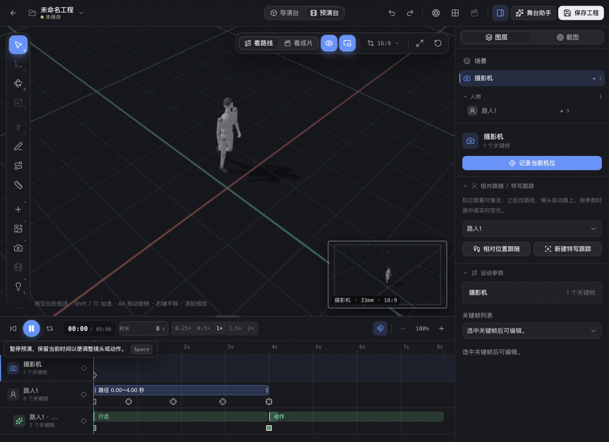

<sub>演示：三维预演台播放人物走位与动作 → 拍摄四视图 → 统一媒体查看器检查 → 送回节点画布并保留来源连线（录制于 2026-11-05 本地演示环境）</sub>

</div>

---

## 项目简介

**Open Storyboard Canvas** 是一款本地优先（Local-first）的桌面 AI 分镜（AI Storyboarding）工作台，将多模型渠道、无限节点画布（Infinite Canvas）、三维导演台与多作用域 Agent 整合进同一工作流。

面向 AI 短片与漫画创作者，覆盖“快速试模型 → 节点化编排 → 三维走位取景 → 素材复用”，项目与素材默认保存在本机。

> 当前源码版本：**v0.2.2**（支持 **macOS** 与 **Windows**）。下文介绍当前源码能力；安装包实际包含的内容请以 [GitHub Releases](https://github.com/ganbo-gab/open-storyboard-canvas/releases) 对应版本为准。

---

## 核心功能

### 1. 生成工作台（Generation Workbench）

- **多模态统一创作**：图片、视频、音频与文本对话集中在同一工作台，按创作会话保存历史，支持搜索、置顶、改名与关联画布项目。
- **高效输入体验**：输入区支持 `@` 检索引用素材、`/` 快捷选择预设、拖入或粘贴参考图、局部撤销与展开编辑；浏览历史时可收起输入区。
- **渠道驱动参数与尺寸映射**：比例、分辨率、时长、数量、首尾帧等参数由渠道声明决定；尺寸支持像素模式与“比例 + 分辨率”双视图切换，底层仍严格映射到接口实际值。
- **结果复用与可追溯历史**：同次生成的多结果完整展示，支持统一查看器预览、下载、设为参考或发送到指定画布；工作台与任务中心完整记录每次提交的模型、参数、提示词与原任务 ID，区分“查询原任务”与“再次生成”。

### 2. 无限节点画布（Infinite Node Canvas）

- **自由编排节点工作流**：支持文本、图片、视频、音频、生成、分镜、全景、导演台与标签组等节点类型，通过连线构建可复用、可持续编辑的 AI 分镜工作流。
- **预设、图片功能与独立摄像机控制**：生成节点支持直接调用预设与 `/` 快捷入口；图片节点连接参考图后可按角色选择编辑功能；摄像机控制采用独立可调弹窗，支持机身、镜头、焦距、光圈与本机预设。
- **非破坏性资产编辑**：图片裁剪、标注、旋转、翻转与音视频本地截取/裁剪/分离音轨均保存为新副本并保留来源连线，不破坏原素材。
- **可定制交互与大图优化**：支持鼠标左/中/右键九项自定义键位（含左拖平移/右拖框选推荐预设）、自定义工具栏、系统剪贴板节点复制与撤销/重做；大画布采用空间索引、可见区域裁剪及带回退的矢量连线缓存。

### 3. 导演台与预演台（3D Director Studio & Previs）

- **三维空间构图与走位**：在三维场景或全景背景中安排人物、道具、灯光与机位，支持多选、变换、姿势动作、地面绘制路线及时间轴关键帧编排。
- **多模式摄影机与四视图回流**：摄影机支持跟随对象、看向固定点与自由旋转；可在任意时刻拍摄单张或四视图，经统一查看器确认后直接送回画布并保留来源连线。
- **3D 资产与录制**：支持全景背景、GLB/glTF 模型导入、录制，以及按已配置模型能力调用图生 3D。
- **舞台 Agent 预演（实验中）**：支持从文字或参考素材出发，由舞台助手组合基础形体搭建空间、安排走位与镜头轨道，并保留为可继续编辑的三维舞台工程。

<details>
<summary>展开查看：舞台 Agent 实际测试截图与演示 GIF 合集</summary>

#### 舞台 Agent 实测参考（2026-11-07 用户测试）

建筑场景、双人相遇、约 15 秒时间轴与多段镜头编排。截图仅展示该次测试结果，不代表每次请求都能达到相同效果。

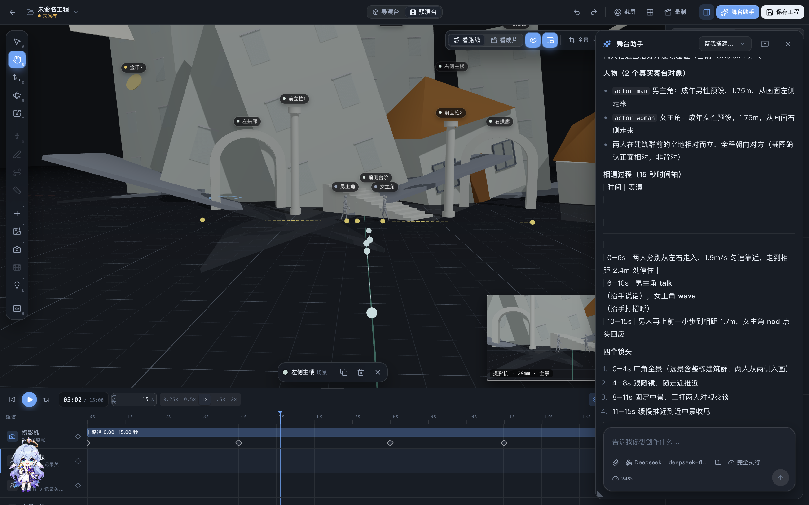

#### 其他核心界面演示 GIF

> 以下演示录制于本地演示配置与测试素材（Agent 为本地模拟回复与工具请求），用于展示桌面界面与交互流程，不代表真实供应商的生成质量或速度。

| 场景 | 预览 |
| --- | --- |
| **渠道与模型**：类别筛选、视图切换与参数查看 | 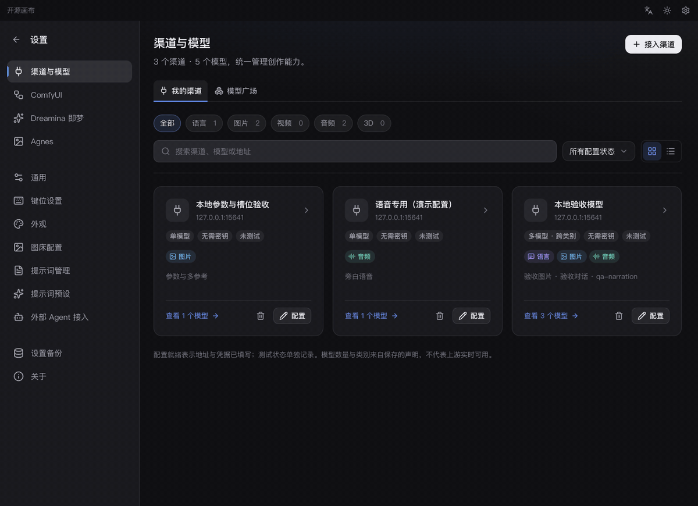 |
| **生成工作台**：输入参数、批量结果与提交追溯 | 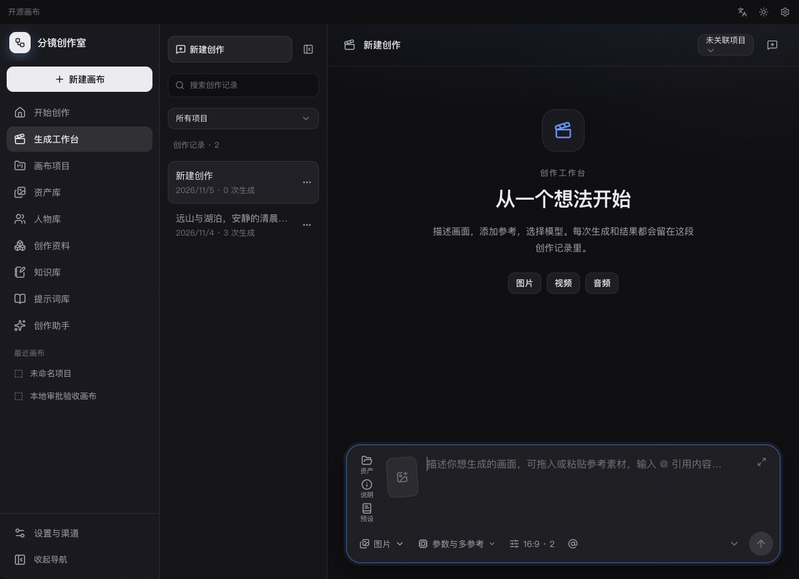 |
| **Agent 审批流**：查看拟执行操作并批准或拒绝 | 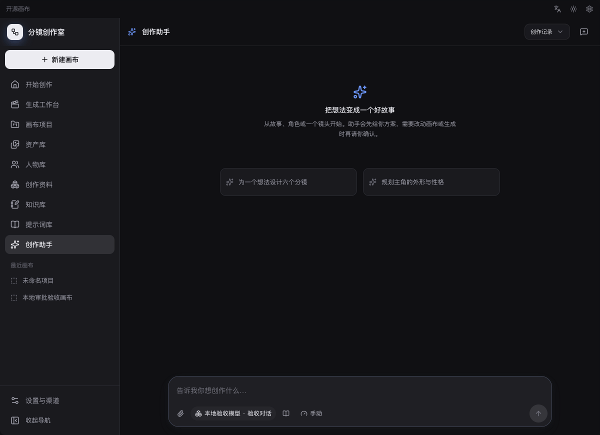 |
| **画布工具栏**：短菜单、自定义数量与节点分组 | 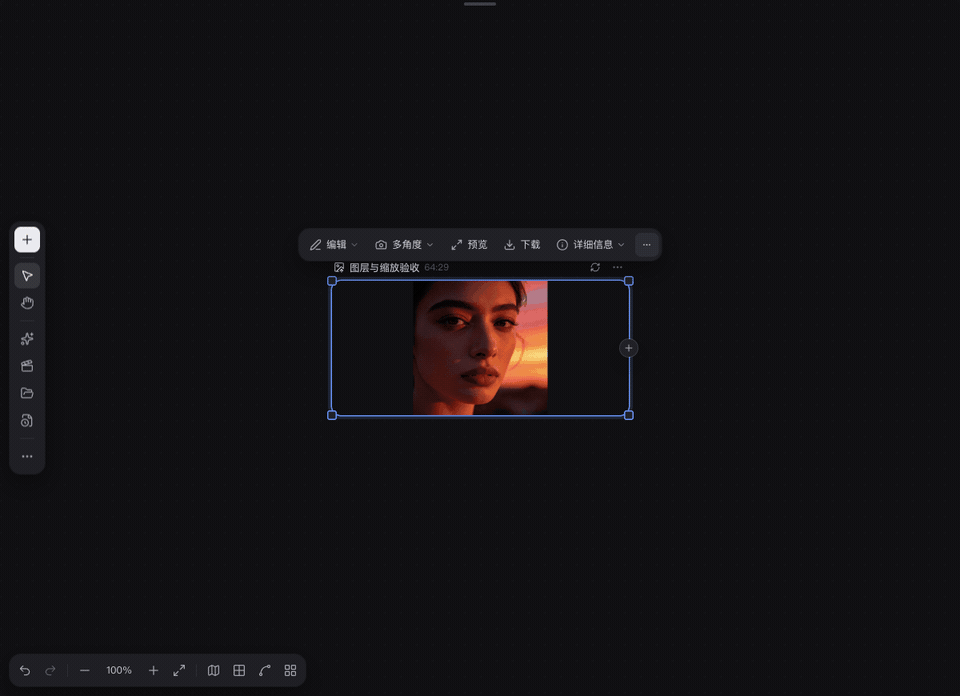 |
| **工作区调节**：拖宽侧栏、双击复位与项目归属 | 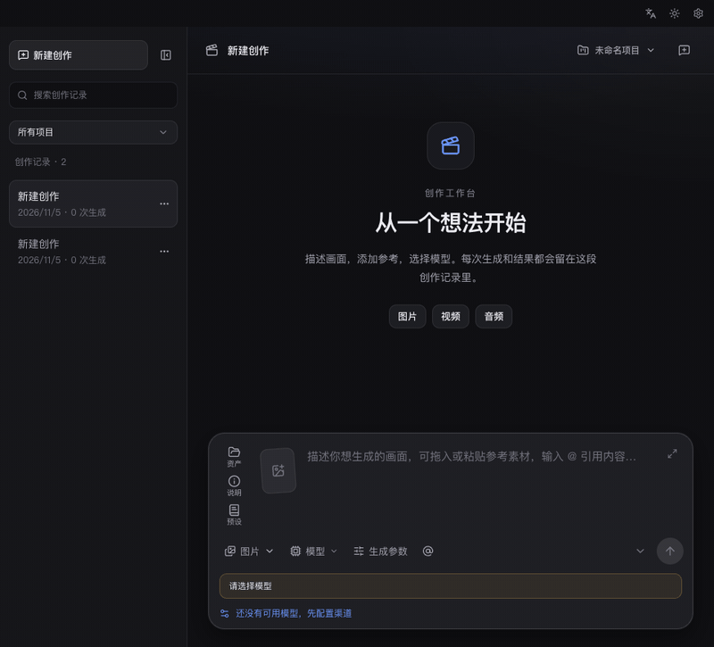 |

#### 静态界面截图

| 界面 | 预览 |
| --- | --- |
| 渠道管理 | 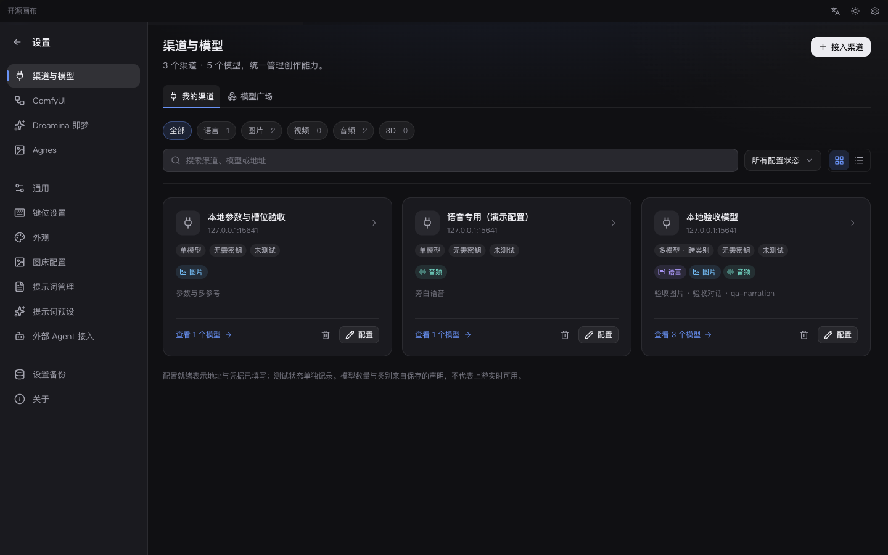 |
| 模型广场 | 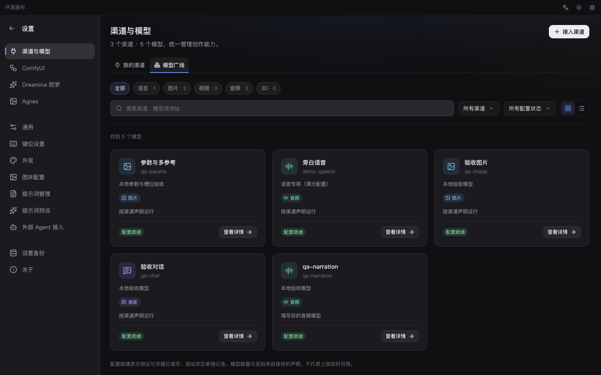 |
| 生成工作台 | 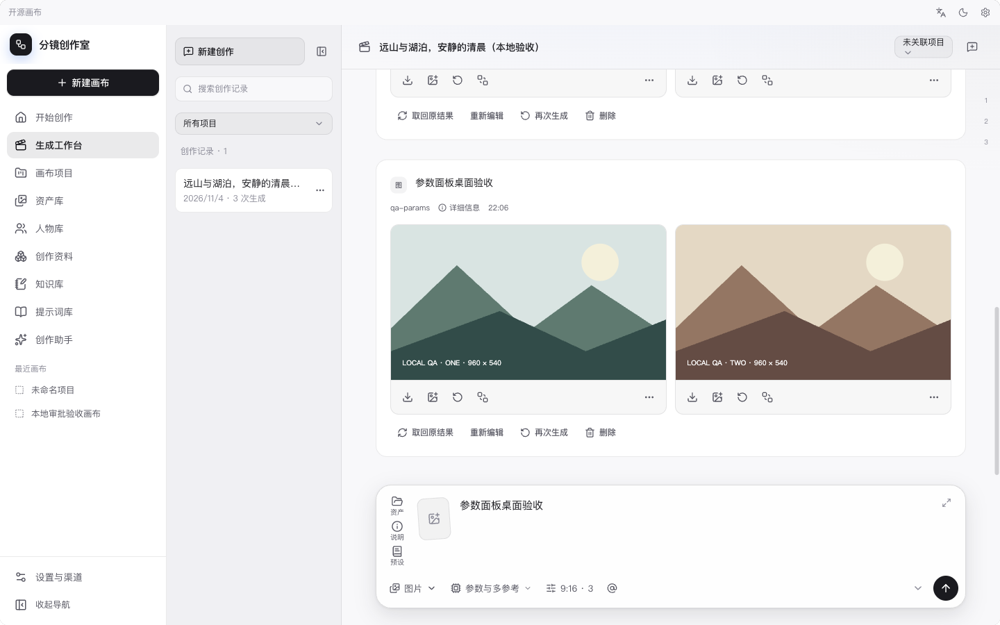 |
| 创作助手 Agent | 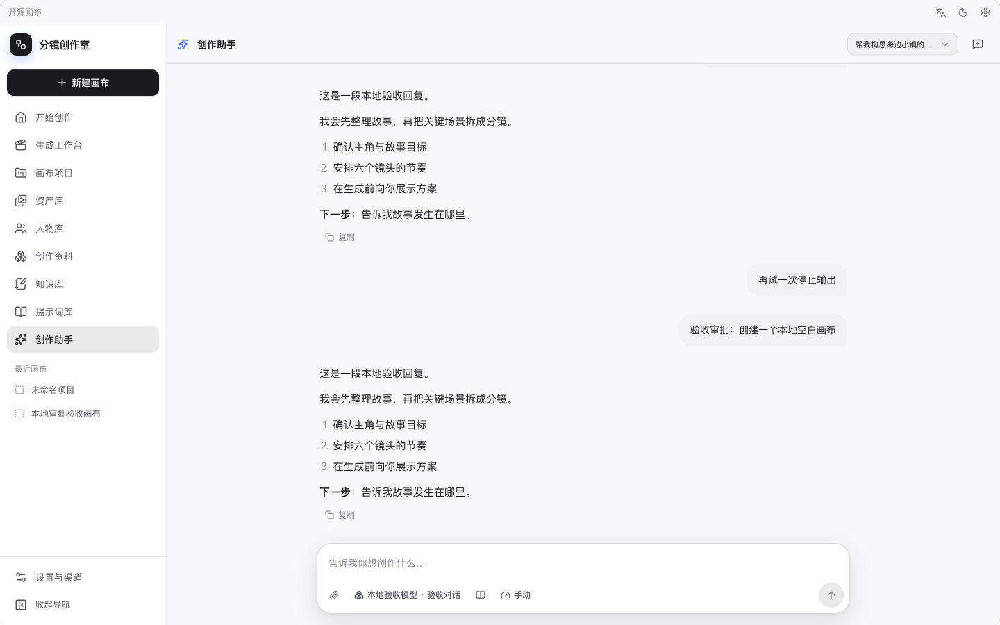 |
| 预演台与时间轴 | 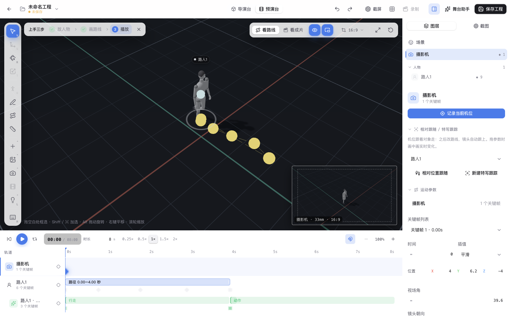 |
| 统一媒体查看器 | 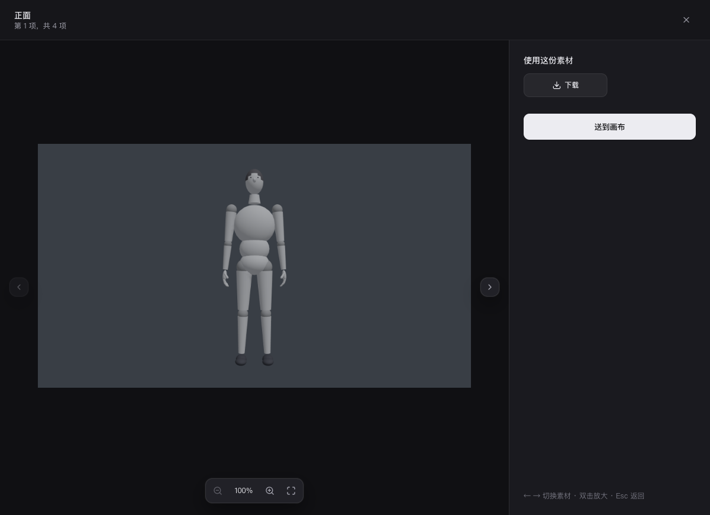 |

</details>

### 4. 多作用域 Agent 与知识库（Multi-Scope Agents）

| Agent 入口 | 主要能力 |
| --- | --- |
| **首页创作助手** | 整理剧本与分镜方案，预览后铺到画布；检索素材；发起工作台生成并查询原任务；辅助生成渠道配置 |
| **画布 Agent** | 读取当前项目与选中内容，创建/编辑节点与连线，发起生成、查看脱敏诊断并支持受修订保护的撤回 |
| **舞台助手** | 查询场景对象、机位、轨迹与动作，预演并应用舞台方案，执行取景/四视图与录制 |

- **可控的三种执行模式**：支持**请求确认**（编辑/生成前确认）、**辅助执行**（自动完成普通编辑，生成/删除/配置需确认）与**完全执行**（授权应用内工具执行）；三种模式均不开放任意系统文件或命令。
- **运行保护与失败续接**：共享单回合最多 96 次工具调用 / 30 分钟限制；遇到临时限流或可恢复服务端错误且未输出时最多自动重试 3 次；支持保留回执续接未完成步骤，不盲目重放未知状态的付费请求。
- **多协议与本地知识库**：按渠道声明适配 Chat Completions、Responses、Anthropic Messages 与 Gemini；支持直接挂载任意本地 Markdown 目录（兼容 Obsidian）用于检索、读取与按权限编辑笔记。

### 5. 多渠道与模型管理（Multi-Provider Channels）

- **单模型与综合中转站统一管理**：「我的渠道」展示连接、凭据与模型状态；「模型广场」支持按文本、图片、视频、音频、3D 筛选查看能力与槽位声明。
- **三种灵活接入方式**：支持协议模板接入、让已配置 AI 阅读接口文档自动生成配置、或粘贴外部 AI 生成的配置 JSON；免费拉取模型列表与计费试运行严格分离，支持批量「统一配置」。
- **生态扩展**：内置 **ComfyUI** 多工作流连接/依赖预检/AI 绑定建议、**Dreamina（即梦）CLI** 专用入口、统一 `audio.generate` 音频渠道，以及用户自配的自定义图床。
- **凭据隔离存储**：API Key 与普通配置分离，分别托管在 macOS 系统钥匙串与 Windows 系统凭据管理器中，普通导出和预览不包含明文密钥。

---

## 快速开始

### 桌面端安装使用

前往 [GitHub Releases](https://github.com/ganbo-gab/open-storyboard-canvas/releases/latest) 下载对应平台安装包（GitHub Tag 页面仅含源码，请勿从 Tag 下载安装程序）：

- **Windows**：下载 `open-storyboard-canvas_<版本>_x64-setup.exe`（若提示缺少 WebView，请安装 [Microsoft Edge WebView2 Runtime](https://developer.microsoft.com/microsoft-edge/webview2/)）。
- **macOS**：下载 `open-storyboard-canvas_<版本>_universal.dmg`（同时支持 Apple Silicon 与 Intel；具体架构以该版本发布文件为准）。

**首次上手 5 步走：**

1. 打开 **设置与渠道 → 渠道与模型 → 接入渠道**，选择模板（或提供接口文档 / 配置 JSON），填写 URL 与 API Key 并勾选需要接入的模型。
2. 在 **我的渠道 / 模型广场** 核对模型类别、输入槽位与参数，按需拉取模型列表或手动发起一次试运行。
3. 进入 **生成工作台** 选择模型，输入提示词或通过 `@` 引用素材发起生成。
4. 将满意的结果下载、作为下一轮参考，或直接发送到 **节点画布** 组合工作流；需要构图走位时进入 **导演台 / 预演台**。
5. 使用内置 **Agent** 时先选择支持工具调用的文本模型，按需切换审批模式并留意任务详情与日志。

<details>
<summary>展开查看：macOS 首次打开提示与钥匙串授权说明</summary>

- **Gatekeeper 拦截提示**：macOS 安装包目前没有 Apple Developer ID 签名和公证。首次打开若被系统拦截，请在「系统设置 → 隐私与安全性」中点击允许打开，或右键应用选择「打开」。
- **为什么会请求访问钥匙串**：从 `v0.2.0` 起，API Key 等凭据交由 macOS 系统钥匙串独立存储。确认请求方为本应用后，在系统弹窗中输入登录钥匙串密码（一般与 Mac 登录密码一致），信任当前版本可点击「始终允许」。请勿将系统密码填入 API Key 栏或发到 Issue / 聊天中。
- **更新后再次弹窗说明**：`v0.2.0`–`v0.2.2` 使用 ad-hoc 临时签名，每次重新构建代码身份会变化，更新版本后每条凭据首次访问仍可能再次请求确认（详见 [macOS 签名说明](docs/release/macos-signing.md)）。若误点「拒绝」，相关任务会暂停，请在应用内凭据恢复入口重新授权后使用「查询/恢复」取回原任务，避免重复提交计费请求。
- Windows 使用系统凭据管理器，不涉及上述 macOS 代码签名钥匙串规则。

</details>

更多配置与进阶指南：
- [渠道与模型使用指南](docs/settings/channel-models-guide.md)
- [ComfyUI 连接指南](docs/settings/comfyui-guide.md)
- [导演台与预演台操作说明](docs/director-previsualization.md)

### 本地开发运行

**环境要求：**
- Node.js `22.22.2+`（22 LTS）、`24.15+`（24 LTS）或 `26+`
- Rust `stable`
- Tauri 2 系统依赖：macOS 需 Xcode Command Line Tools；Windows 需 Visual Studio C++ Build Tools 与 WebView2（详见 [基础工具安装](docs/development-guides/base-tools-installation.md) 与 [开发环境指南](docs/development-guides/project-development-setup.md)）

```bash
git clone https://github.com/ganbo-gab/open-storyboard-canvas.git
cd open-storyboard-canvas
npm install

# 仅启动前端开发服务
npm run dev

# 启动桌面端应用（Tauri 2）
npm run tauri dev
```

<details>
<summary>展开查看：质量检查命令与项目目录结构</summary>

#### 质量检查

```bash
npm test
npx tsc --noEmit
npm run build
npm run check:line-endings

cargo fmt --manifest-path src-tauri/Cargo.toml -- --check
cargo check --manifest-path src-tauri/Cargo.toml
cargo test --manifest-path src-tauri/Cargo.toml
```

#### 目录结构

```text
src/
  commands/                 # TypeScript → Tauri 命令桥接
  components/               # 通用组件与设置页
  features/studio/          # 首页、页面导航与素材交接
  features/workbench/       # 生成会话、任务与输入区
  features/channels/        # 渠道声明、模板、模型目录与执行
  features/agents/          # 首页/舞台 Agent 与共享会话界面
  features/canvas/          # 节点、连线、画布 Agent 与图编辑命令
  features/stage/           # 舞台命令、动作、取景与界面
  features/library/         # 素材、历史与追溯详情
  features/viewer/          # 图片/视频/音频统一查看器
  features/portability/     # 项目和应用设置迁移
  features/promptLibrary/   # 提示词库
  stores/                   # Zustand 状态与持久化协调
  i18n/                     # 中英文语言包
src-tauri/
  src/commands/             # Rust Tauri 命令、网络代理与本地系统能力
  src/ai/                   # AI 供应商适配
  tauri.conf.json           # 桌面应用配置
docs/                       # 使用、开发、发布与授权文档
```

</details>

---

## 技术栈与支持平台

| 类别 | 技术选型 |
| --- | --- |
| 桌面端框架 | **Tauri 2** |
| 前端框架 | **React 19**、**TypeScript**、**Tailwind CSS**、**Zustand** |
| 节点画布与 3D 舞台 | **React Flow (`@xyflow/react`)**、**Konva**、**Three.js**、**Photo Sphere Viewer** |
| 后端与本地存储 | **Rust**、**SQLite (`rusqlite`)**、系统凭据存储（`keyring`） |
| 支持平台 | **macOS**（Apple Silicon / Intel，macOS 11.0+）、**Windows**（x64 + WebView2） |

---

## 说明与边界

本项目坚持实事求是的功能边界说明，不做过度承诺：

- **测试与验证边界**：截至 `2026-11-09`，前端自动化检查为 350 文件 / 3208 项通过，另含 Rust 渠道快照合同测试及受控环境下的 Agent / 任务健康回归。受控回归不代表所有第三方上游与中转站实测通过；Mac 原生窗口与千节点缩放已做实机验证（1000 节点场景仍有首次低倍率长帧，不承诺任意千节点恒定 60fps），Windows 原生交互与全套真实供应商编排仍有待更多实机验收。详细记录见 [模型配置报告](docs/implementation/2026-11-09-model-configuration/report.md)、[Mac 原生缩放报告](docs/implementation/2026-11-06-native-zoom/report.md)、[Agent 可靠性报告](docs/implementation/2026-11-07-agent-resilience/report.md) 与 [docs/rework](docs/rework/)。
- **实验性功能限制**：内置 Agent 与舞台 Agent 仍处于持续测试迭代阶段，长任务、多中转站工具协议与图片理解可能存在兼容差异；舞台当前主要通过基础形体与导入资产组合空间（单对象 V1 空间轨道），不等同于精细网格建模，也不保证 100% 还原参考图或每次执行零误差。
- **音频与外部接口**：音频统一使用 `audio.generate` 渠道（直接返回二进制音频流的 TTS 端点仍需单独适配）；渠道模型预设仅作能力参考，不代表任意中转渠道均可用。
- **macOS 签名现状**：当前仍为临时签名（ad-hoc），固定签名已暂缓，更新后钥匙串可能再次要求确认，不承诺零弹窗（详见 [升级与凭据验收说明](docs/implementation/2026-11-09-credentials-composer/upgrade-followup.md)）。
- **数据、隐私与费用**：项目、历史与媒体引用默认保存在本机，无云同步账号；生成请求会按你的配置发送至对应供应商或本地工具，费用、内容审核与数据条款以供应商为准。已提交的上游付费请求不会因关闭面板或撤销画布而取消。

---

## 更新日志

完整历史发布请查看 [GitHub Releases](https://github.com/ganbo-gab/open-storyboard-canvas/releases)：

- **v0.2.2** — 统一实际请求、Agent 查询与历史诊断的模型配置，移除新节点残留默认值；等待图按真实提交尺寸显示比例，优化数量面板与单行布局；修复凭据闲置误锁与临时故障持续阻断问题，清理约 1360 行冗余旧代码。详见 [v0.2.2 更新说明](docs/releases/v0.2.2.md)。
- **v0.2.1** — 支持鼠标左/中/右键单击、双击与拖动共 9 项独立键位配置与滚轮设置，提供推荐与传统预设；修复抓手锁住编辑、双击创建失效与框选菜单冲突并兼容旧备份。详见 [v0.2.1 更新说明](docs/releases/v0.2.1.md)。
- **v0.2.0** — 围绕画布引擎、统一渠道、生成与任务恢复、Agent 执行、凭据隔离与素材管理进行大规模模块拆分与规范化，界面与 Agent 复用统一服务层。详见 [v0.2.0 更新说明](docs/releases/v0.2.0.md)。

---

## 交流、贡献与协议

### 交流与反馈

- **QQ 交流群**：`1025837759`（交流使用经验、工作流与功能建议）
- **Issue 追踪**：[GitHub Issues](https://github.com/ganbo-gab/open-storyboard-canvas/issues)（特别欢迎提交 Agent 执行异常、工具协议兼容与复现步骤）

### 贡献指南

欢迎提交可复现的 Bug、供应商/模型适配、性能优化、文档修正与交互改进，开始前请阅读 [CONTRIBUTING.md](CONTRIBUTING.md)。提交 Issue 时请附带应用版本、操作系统、供应商/模型信息及可复现步骤，**切勿公开 API Key、系统密码、Authorization 请求头或私人素材**。

### 开源协议与上游归属

本项目基于 **Storyboard-Copilot** 二次开发，已获得原作者公开/书面聊天授权继续开发与开源（授权条件为保留原作者名称与原项目链接）：

- 原作者：痕继痕迹 / henjicc
- 原项目：[henjicc/Storyboard-Copilot](https://github.com/henjicc/Storyboard-Copilot)
- 授权记录：[docs/legal/upstream-author-authorization-2026-05-31.jpg](docs/legal/upstream-author-authorization-2026-05-31.jpg)
- 归属声明：[NOTICE](NOTICE)
- 本项目新增代码与资源按 [MIT License](LICENSE) 开源。

感谢 [Linux Do](https://linux.do) 社区、原项目作者以及所有提交 Issue、PR 与测试反馈的用户。

### 安全与免责声明

- 安全漏洞披露与隐私细节请阅读 [SECURITY.md](SECURITY.md)。
- 用户自行管理 API Key、本地凭据、供应商配置、CLI 登录态及相关费用；第三方供应商服务稳定性、审核规则与 AI 生成内容的版权/合规风险由用户自行评估与承担。
- 本项目按“现状”提供，不承诺任何第三方供应商、模型、Agent 决策或生成结果始终可用或适合特定用途。
