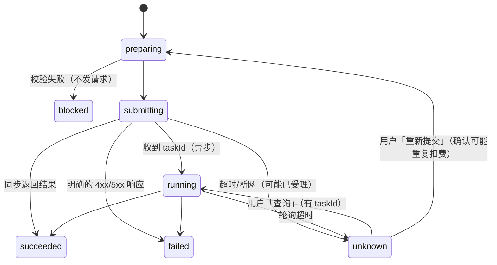
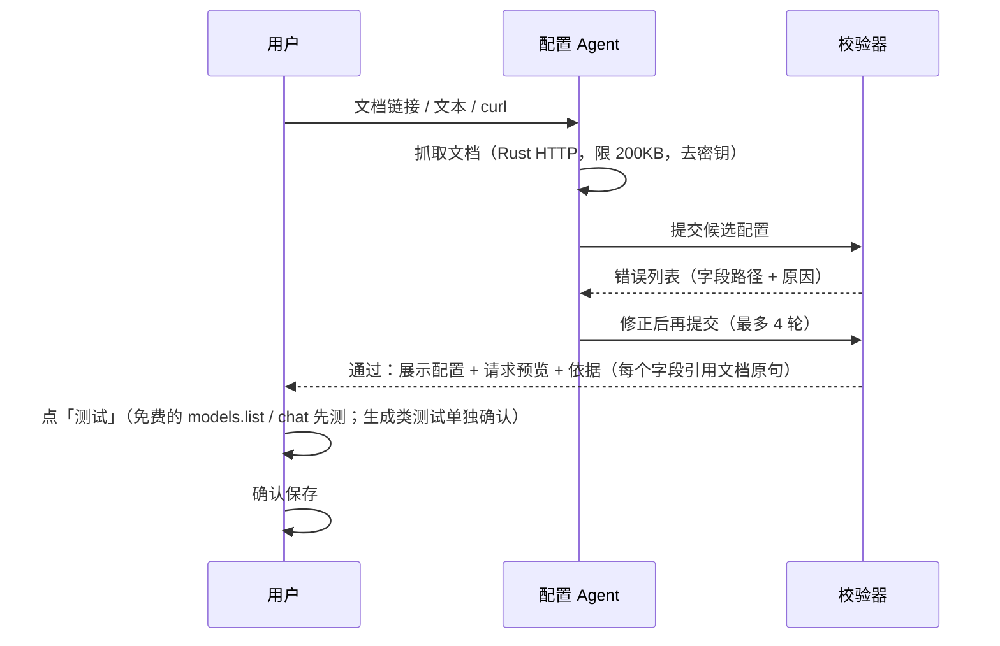

# 02 · 渠道接入规格（渠道配置 v2）

> 目标：大多数中转站「选模板 + 填 Key」即可用；非标中转站通过「文档 → 配置」一条龙或「复制提示词 → 回贴配置」接入；任何情况下发出去的请求都干净、可预览、可解释。

## 1. 要消灭的问题（证据）

| 来源 | 问题 | 本规格的对策 |
|---|---|---|
| #5 | Gemini 比例/尺寸写到 `generationConfig.responseFormat.image.*`，官方是 `generationConfig.imageConfig.*`；`1k` 小写被拒 | 字段位置由模板决定；值由参数映射表决定（`2K` 原样或映射），不再有内部推断 |
| #7 | 中转站 `/v1/chat/completions` 生图失败；慢请求被自动重试导致重复扣费 | 操作（operation）显式区分；歧义提交进入 `unknown` 态，只允许「查询」或用户手动「重新提交」 |
| #9 | `/v1/images/edits` 报 `Model name not specified`；`auto` 比例 + 固定尺寸出怪比例 | 模板必填变量缺失 = 校验失败、不发请求；比例与尺寸是同一参数的两种映射，不再并发两个字段 |
| #10 | `referenceImages` 是数组但上游 `image` 是单张；multipart 是否 `image[]` 不可控 | 文件字段显式声明 `field` + `cardinality: single|array|repeat` |
| #19 | ComfyUI 配置隔天连不上 | ComfyUI 保留独立适配器；连接测试给出具体失败环节（地址/队列/节点缺失） |
| 旧版代码 | `buildRequestBody` 把默认参数 + `extraParams` + 推断 hints 全部 spread 进请求体；AI 配置助手 schema 有 14 种 templateKey | 请求体 = 模板渲染结果，别无来源；配置 schema 收敛为下文一种形状 |

## 2. 核心概念

```
渠道 Channel（一个中转站/供应商账号）
 ├─ 连接：baseUrl + 鉴权 + 静态请求头
 ├─ 操作 Operation：chat | image.generate | image.edit | video.generate | audio.generate | models.list
 │    每个操作 = 一个 HTTP 请求模板 + 响应解析（同步或异步轮询）
 └─ 模型 Model：上游模型名 + 支持哪些操作 + 参数表 + 参考素材上限 + @ 引用方言
```

非 HTTP 模板类渠道（ComfyUI、MiniMax H3 本地、即梦 CLI、本地音频）不进模板体系，作为**特殊适配器**实现同一个执行接口（§6）。

## 3. 配置形状（zod strict，未知字段一律拒绝）

```ts
interface ChannelProfileV2 {
  version: 2;
  id: string;
  name: string;
  baseUrl: string;                       // 不含尾斜杠
  auth:
    | { type: 'bearer' }                 // Authorization: Bearer <key>
    | { type: 'header'; name: string; prefix?: string } // 如 x-goog-api-key；Fal 为 Authorization + prefix: 'Key '
    | { type: 'query'; name: string }    // 如 ?key=
    | { type: 'none' };
  headers?: Record<string, string>;      // 静态、非密钥；含密钥字样的键名拒绝保存
  docsUrl?: string;
  notes?: string[];                      // 文档里的限制说明，展示给用户，不参与请求
  operations: Partial<Record<OperationKind, OperationSpec>>;
  models: ModelSpec[];
}

type OperationKind = 'chat' | 'image.generate' | 'image.edit' | 'video.generate' | 'audio.generate' | 'models.list';

interface OperationSpec {
  method: 'POST' | 'GET';
  path: string;                          // 可含 {{model}}
  body: 'json' | 'multipart' | 'none';
  template?: Template;                   // json：整个请求体；multipart：文本字段
  files?: {                              // 仅 multipart
    field: string;                       // 'image' / 'image[]' / 'input_reference'
    cardinality: 'single' | 'array' | 'repeat';
  };
  imageEncoding?: 'url' | 'data-url' | 'base64';   // json 体内图片的编码，默认 data-url
  response: SyncResponse | AsyncResponse;
  errorPath?: string;                    // 上游错误文本所在路径，如 'error.message'
}

interface SyncResponse { mode: 'sync'; outputs: OutputSpec[] }
interface AsyncResponse {
  mode: 'async';
  taskIdPath: string;                    // 提交响应里的任务 ID，如 'id' / 'data.task_id'
  poll: {
    method: 'GET' | 'POST';
    path: string;                        // 含 {{taskId}} 或 {{submit.status_url}}；后者可为同源绝对 URL
    template?: Template;
    intervalSec: number;
    timeoutMin: number;
    statusPath?: string;                 // 缺省按输出存在判定完成、errorPath 有值判定失败
    success: string[];                   // ['completed', 'succeeded']
    failure: string[];                   // ['failed', 'cancelled']
    progressPath?: string;
    outputs: OutputSpec[];
    resultRequest?: {                    // 状态成功后再获取结果，如 Fal
      method: 'GET' | 'POST';
      path: string;                      // 可用 {{submit.response_url}}
      template?: Template;
    };
  };
}

type OutputSpec = {
  path: string;                          // 'data[*].url'；'data.resultJson|json.resultUrls[*]' 显式解析 JSON 字符串后继续取值
  as: 'url' | 'base64' | 'data-url';
  kind?: 'image' | 'video' | 'audio';      // 缺省取操作的媒介
} | {
  url: string;                           // 模板，如 '/v1/videos/{{taskId}}/content'；仅相对路径或同源绝对 URL
  kind: 'image' | 'video' | 'audio';
  auth?: boolean;                        // true 时给输出下载附渠道鉴权，缺省不附；仅在轮询成功后产生结果
};

interface ModelSpec {
  id: string;                            // 上游模型名，原样进入 {{model}}
  label?: string;
  operations: OperationKind[];
  params: ParamSpec[];
  refs?: { image?: number; video?: number; audio?: number };   // 缺省 0 = 不支持
  mention?: 'zh-at' | 'en-at' | 'zh-bare' | 'natural';         // 缺省 natural（最安全）
}

interface ParamSpec {
  key: string;                           // 模板里以 {{param.<key>}} 引用
  label: string;
  type: 'enum' | 'number' | 'boolean' | 'text';
  options?: { label: string; value: JsonValue }[];   // enum：界面显示 label，发送 value
  min?: number; max?: number; step?: number;
  default?: JsonValue;                   // 无 default 且用户未设置 → 该字段不发送
  required?: boolean;
}
```

### 3.1 模板变量

| 变量 | 含义 |
|---|---|
| `{{model}}` | 模型 id |
| `{{prompt}}` | 编译后的提示词（@ 引用已按模型 `mention` 方言展开） |
| `{{param.<key>}}` | 参数值，类型保持（数字仍是数字） |
| `{{images}}` / `{{image}}` | 参考图数组 / 第一张，编码按 `imageEncoding` |
| `{{videos}}` `{{audios}}` | 同上 |
| `{{messages}}` | chat：标准化消息数组 |
| `{{taskId}}` | 仅轮询 |
| `{{submit.<path>}}` | 仅轮询/结果请求：提交响应的字段，如 `submit.status_url`；绝对 URL 必须与渠道同源，避免密钥外泄 |

模板值整串等于一个变量时保留原类型；嵌入字符串中时按字符串拼接（`"{{param.w}}x{{param.h}}"`）。

`param.<key>.<path>` 可读取对象型 enum 值的子字段，以保持比例/尺寸映射同一选择。响应路径中的 `|json.` 显式解析前段选中的 JSON 字符串，解析失败视为缺值；不隐式猜测或解析字符串。轮询先检查失败状态；`statusPath` 缺省或 `success` 为空时，以非空输出判定成功。动态轮询所需提交响应由适配器缓存；重启恢复时调用方通过 `getSubmitResponse` 提供已持久化的非敏感响应字段。

同步预览 `renderPreview` 不读磁盘；异步 `renderRequest(profile, job, apiKey, resolveRef)` 注入引用编码函数，返回实际请求与打码预览，两者共用渲染路径。`JobRef` 无字节数时只展示已知尺寸/MIME，不编造文件大小。聊天通过 `job.messages`（缺省由 prompt 构造单条 user 消息）渲染，结果为 text 输出；`models.list` 由 `listModels` 返回模型 ID。

### 3.2 硬规则

1. **请求体 = 模板渲染结果。** 不合并默认参数、不合并旧 `extraParams`、不做正则推断。
2. **变量必须有声明。** 模板引用未声明的 `param.*` → 配置校验失败，无法保存。
3. **缺值即省略。** 可选参数未设置且无 default → 所在字段整体省略（不发 `""`/`null`）。
4. **必填缺值即阻断。** `{{model}}`、`{{prompt}}`、`required` 参数缺值 → 不发请求，界面指出缺哪个。
5. **参数只来自模型声明。** 界面参数面板由 `ModelSpec.params` 生成；比例、尺寸、时长只能从声明的选项选。
6. **预览与发送同源。** `renderRequest(profile, op, input)` 同时用于预览与发送；预览中密钥打码、图片显示为 `<image 1: 1024×1024 png 812KB>`。

## 4. 执行与任务状态



- 执行器在 TS：渲染请求 → 经 Rust `custom_http_request` 发出（绕过 WebView CORS）。
- 任务记录走 Rust 已有的 `create_generation_job` / `update_generation_job_record`：保存 `channelId / modelId / operation / upstreamTaskId / state / 结果 assetId`，**不保存 Key 与图片数据**。应用重启后对 `running` 任务按 `upstreamTaskId` 继续轮询。
- 结果立即下载转存为本地资产（上游链接普遍有时效）。
- 自动重试只允许：提交前的连接失败（DNS/拒绝连接，确定未发出）与轮询请求本身失败。
- 数量 `count`：模型声明 `param` 中有 `n` 类参数则原生多张；否则执行器拆成多个独立任务。

### 4.1 错误归一化

| 条件 | 归类 | 用户看到 |
|---|---|---|
| 401 / 403 | 鉴权 | Key 无效或无权限（附上游原文） |
| 402 | 余额 | 余额不足 |
| 404 | 路径/模型 | 接口路径或模型名不存在（附实际请求的 URL） |
| 413 | 文件过大 | 参考素材超出上游限制 |
| 429 | 限流 | 并发或额度限制 |
| 5xx | 上游 | 上游服务错误（附原文） |
| 审核类关键词 | 内容审核 | 输入/输出违规，不可重试 |

上游原文按 `errorPath` 取出原样展示；所有失败都能一键打开「本次请求预览」。

## 5. 接入方式

### 5.1 模板（默认路径）

内置预设（每个都是一份完整 `ChannelProfileV2`，用户只填 baseUrl + Key，可再拉模型）：

| 预设 | 覆盖 |
|---|---|
| OpenAI 标准 | chat、images/generations、images/edits（multipart `image[]`）、models |
| OpenAI 兼容中转（new-api / one-api 系） | 同上 + `/v1/videos` 异步 |
| Gemini 原生 | `generateContent`，`imageConfig.aspectRatio/imageSize`，`x-goog-api-key` |
| Anthropic | messages |
| 异步任务通用 | 提交 + 按 taskId 轮询骨架，用户补路径 |
| 现有内置供应商 | ppio / grsai / fal 提供可表达的 HTTP 预设；Kie 前置上传不能由模板表达，保留 Rust provider。所有 Rust provider 在端到端等价前保留；预设 notes 明示协议限制，不静默丢弃能力 |

### 5.2 本地 Agent 一条龙

输入：文档链接、粘贴的文档文本、或 curl 示例（可多份）。



Agent 工具只有：`fetch_doc`、`validate_profile`、`render_preview`。**Agent 不能保存、不能发生成请求**；保存与付费测试必须用户点击。

Agent 指令要点：只写文档明确出现的字段；可选参数未在文档出现则不写；每个参数附 `evidence`（文档原句，仅在审阅界面展示，不入库）。

### 5.3 复制提示词 → 回贴

1. 用户点「复制提示词」，得到：精简 schema 说明（由 zod schema 生成，≤ 2KB）+ 两个示例（OpenAI 兼容同步图片、异步视频）+ 输出要求「只输出一个 JSON 代码块；文档没写的字段不要写」。
2. 用户把提示词 + 中转站文档发给自己的 AI，把回复整体粘回。
3. 抽取 JSON → 同一个校验器 → 错误以中文 + 字段路径列出（可再复制「错误说明」给 AI 修）→ 预览 → 测试 → 保存。

### 5.4 审阅界面（两条路径共用）

左：表单视图（连接 / 操作 / 模型三栏，字段可改）；右：所选操作的**实时请求预览**（URL、打码后的请求头、请求体）。保存按钮在测试通过前显示「未测试」提示，但不强制。

## 6. 执行接口（模板渠道与特殊适配器共用）

```ts
interface ChannelAdapter {
  submit(job: JobInput): Promise<SubmitResult>;          // done | submitted(taskId) | failed | unknown
  poll?(job: JobInput, taskId: string): Promise<PollResult>;
  cancel?(job: JobInput, taskId: string): Promise<boolean>;
  preview?(job: JobInput): RequestPreview;               // 模板渠道必有
}
```

模板渠道由一个通用 `TemplateAdapter` 实现；ComfyUI、MiniMax H3、即梦 CLI、本地音频各自实现该接口，复用现有 gateway 的已验证逻辑（拆小后迁入）。

## 7. 迁移

- 首次启动把旧 `CustomProviderConfig`（`apiStyle` + `endpointPath` + `imageRequestContract` + `responseFormat`）转换为 `ChannelProfileV2`。
- 旧 `extraParams` 中能对应到参数的转为 `ParamSpec`（带 default）；对应不上的列入「未迁移字段」清单，在渠道页顶部提示一次，可一键复制。
- 旧配置原样备份到 `legacy_custom_providers`，保留一个版本周期后删除。

## 8. 代码布局

```
src/features/channels/
  domain/profile.ts        zod schema + 类型
  domain/template.ts       变量解析、渲染（纯函数）
  domain/response.ts       路径取值、结果/错误解析
  domain/errors.ts         错误归一化
  presets/*.ts             内置预设
  migrate/legacyConfig.ts  旧配置迁移
  runtime/templateAdapter.ts
  runtime/channelExecution.ts  任务状态机 + 持久化 + 轮询恢复
  runtime/comfyExecution.ts    旧 ComfyUI 配置到不可变执行快照的桥接
  runtime/transport.ts         Tauri 原生 HTTP / 非 Tauri 浏览器 HTTP
  adapters/{comfyui,minimaxH3,dreaminaCli,localAudio}/
  application/channelService.ts          CRUD / 导入 / 预览 / 免费测试 / 显式付费试运行
  application/configurationAssistant.ts  文档获取与脱敏 / 复制提示词 / 最多四轮严格校验
  store/channelStore.ts                  独立配置与凭据持久化 / 旧配置审阅迁移
src/features/settings/channels/   设置页 UI（主代理编写）
```

## 9. 验收

- issue 回归用例（mock 上游）：#5 Gemini `imageConfig` + `2K` 原样；#7 慢请求超时 → `unknown` 且未重发；#9 edits 缺 model 被阻断；#10 `single`/`array`/`repeat` 三种 multipart 形态逐字节符合预期。
- 每个预设：预览快照测试（固定输入 → 固定请求）。
- 迁移：现有 `customProvidersStore` 测试夹具全部可转换，未迁移字段清单准确。
- 手测：用一个真实中转站走完 5.2 与 5.3 两条路径。

## 10. 应用层接线状态（2026-10-17）

- 原生 v2 渠道由 `createChannel` / `updateChannel` / `deleteChannel` 管理，`useChannelStore.channels` 提供订阅；凭据单独保存在 `channel-credentials-storage`，不在配置、导出 JSON、任务描述符或日志中。该存储是独立本机持久化，不宣称操作系统加密保险库。
- 原生渠道按图像 / 视频 / 文本投影进现有 `customProvidersStore`，使用原有 `custom:provider:model` 模型 ID 和 `tauriAiGateway`；投影不写入旧配置存储。保存后现有三个模型目录立即可见。`resolveNativeChannelModel(catalogId)` 提供准确模型参数声明，执行器只取声明的 `extra_params`，不推断比例/尺寸或合并旧传输 hints。
- 旧配置原样备份到 `legacy_custom_providers` 并生成 `origin: legacy` 审阅记录；不因自动迁移替换已验证网关。用户显式保存为 v2 才切换；内置、Kie、CLI、MiniMax H3 等未完成等价迁移的路径在网关明确保留。
- 模板执行器走 `TemplateAdapter`，Tauri 仅调用 `custom_http_request`，原生错误不会退回浏览器请求；浏览器开发环境才用 `fetch`（上游仍需允许 CORS）。请求预览与实际发送共用模板渲染器。
- v2 任务使用 `custom-local-channel-job-*`；ComfyUI 使用 `custom-local-comfy-v2-*`，均经原有轮询门面分发。桌面端使用既有 Rust 任务表，浏览器使用本地任务记录与 IndexedDB 二进制资产。结果立即转存；任务记录不保存素材字节、密钥或展开后的用户提示词/消息。
- Rust 任务持久化识别 `version:2 + adapter:template|comfyui` 有界描述符，保留完整嵌套模板/工作流，超限硬失败，不再套用旧描述符的四层/32项裁剪。旧描述符校验保持不变。
- 异步恢复只保存 task ID 与被轮询/结果模板明确引用的非敏感标量提交字段。不会重构完整上游响应，也不会重发 unknown 任务。无 task ID 的歧义提交要求用户核对上游；有 task ID 则只查询。配置修改不改变运行任务的已保存 profile/workflow。
- `testChannelModels` 仅运行明确声明的 `models.list`，不回退到付费 chat/生成；`submitChannelSmoke` 返回持久任务 ID，是单独的显式付费边界。导入、保存、配置助手从不隐式调用它。
- 文档 URL 抓取不带渠道凭据，桌面/浏览器均有 200KB 硬限制，超限报错而非截断；粘贴文档使用相同总量限制。助手通过已有文本模型网关生成单个严格 profile，最多四轮，证据只接受原文中出现的引用。复制提示词包含完整 Zod 生成 JSON Schema 和两个示例：为避免丢失字段，该完整 schema 不承诺旧草案的 2KB 压缩目标。
- 原生 OpenAI 工具聊天是显式模板路径：`messages` 保留 `tool_calls/tool_call_id/name`，chat 新增可选 `tools/toolChoice` 变量；只有 POST JSON 同步 `/chat/completions` 且模板明确转发消息和工具时，模型目录才声明 `supportsTools`。Agent 仍用原 SDK 与现有响应 codec，消费瞬时真实 `choices/tool_calls`；不把原始响应写入恢复快照。其他协议未完成适配前不宣称工具/流式能力。
- ComfyUI 旧编辑器保存格式不变；执行时映射旧 bindings 与全部 `outputNodeIds` 到 snapshot adapter（输出绑定为 `$output`）。工作流、绑定、输出节点、URL、鉴权方式独立快照；凭据执行时注入。恢复不依赖用户后续编辑的 workflow，不重新提交 `/prompt`。
- 新增 TS 行为用例覆盖保存/删除/多目录投影、旧特殊渠道保留、模板实际请求、未知提交不重发、task ID 恢复、工具调用进出 codec、原生/浏览器路由和文档限额；Rust 用例覆盖 v2 描述符保真/敏感字段/超限拒绝。集中验证由主线程执行，不能把仅写入的用例称为已通过。
- Zustand 的渠道、凭据、旧供应商存储统一显式注入 storage：浏览器正常使用真实 localStorage 与真实 hydration 回调；Node/SSR 或无浏览器存储时使用明确的进程内存存储，仍完整初始化 store/persist API 与订阅。浏览器不可访问存储时警告其非持久模式，不假装已落盘。运行期发现的真实写入失败仍向外抛出，不用内存静默覆盖失败。
- ComfyUI 在结果下载前保存去除鉴权参数的 `/view` 恢复地址；成功落盘后仍保留该安全句柄。任务数据库写入错误保留 `storage` 分类和上游任务 ID/安全结果 URL，不被通用 ComfyUI 错误覆盖；成功状态仅在成功记录写入完成后对外发布。
- v2 描述符仅在 `profile.auth` / `comfyuiSnapshot.auth` 校验鉴权配置对象；URL 输出声明和恢复输出的 `auth:boolean` 按输出结构接受，不误判为凭据对象。重新载入 `materializing` 且有保存输出的任务会直接继续下载，即使同步任务没有 task ID；轮询 HTTP 401/403/404 保留 task ID 为可恢复等待，修正连接/凭据后仅查询，只有上游明确任务失败才终止。
- 浏览器成功任务的首次轮询与“重新查询”共用单次 hydration：先从 IndexedDB 恢复媒体并创建本进程 URL，再放入任务缓存或返回成功；不暴露已失效的上次运行 blob URL。恢复读取失败不会把过期成功记录写入缓存，后续修复后仍可再次读取，不产生生成提交。

