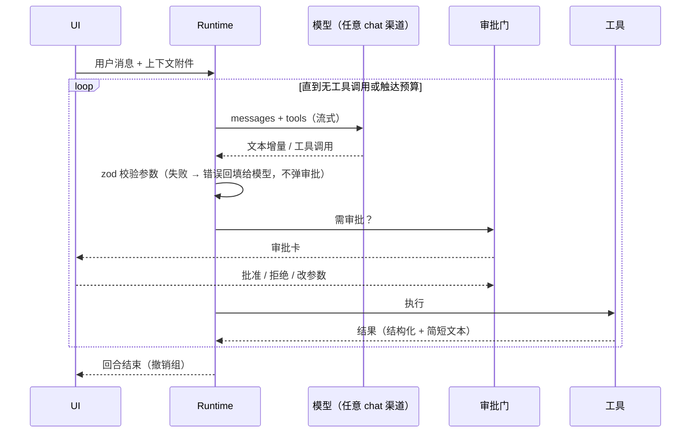

# 06 · Agent 规格

> 一个运行时，三个 Agent：首页 Agent、画布 Agent、舞台 Agent。外部 Agent（Codex / Claude CLI）复用同一套工具注册表，经 MCP 暴露。

## 1. 现状问题

| 问题 | 证据 |
|---|---|
| 运行时 1507 行 + 控制器 1070 行 + 审批 44KB，依赖 `@openai/agents` 再套一层多协议编解码 | `agent/infrastructure/sdkRuntime.ts`、`agentProviderCodec.ts` |
| 工具用泛化 `input: object`，模型猜字段 | LRN-20260813-001 |
| 额度/限流错误被错标到当前模型；连点产生重复回合 | LRN-20260814-001/002 |
| 只有画布 Agent；首页、导演台没有 | `agent/` 目录 |

## 2. 运行时（保留 `@openai/agents`，凭证据再评估替换）

当前决策：复用现有 SDK Runner、流式适配、审批恢复和供应商编解码，不以代码行数为由另建运行循环。先让 home / canvas / stage 三种作用域共用该运行时并完成真实工具流程；只有兼容性、正确性或可维护性测试提供明确反例后，再单独评估替换。下面是应用拥有的执行契约，而不是移除 SDK 的实施指令。



- 协议：OpenAI Chat Completions、OpenAI Responses、Anthropic Messages、Gemini；由 02 的 `chat` 操作提供，运行时只见归一化后的 `{text, toolCalls}`。
- 模型能力检查：渠道模型需声明支持工具调用，否则 Agent 入口提示更换模型。
- 单回合门：同一会话同时只有一个运行中回合；发送按钮在回合中变为「停止」。
- 预算：每回合最多 24 次工具调用、最长 10 分钟；到顶时停下并说明。
- 错误归因：错误带渠道 + 模型 + 操作三元组，展示时不猜测。
- 会话持久化：沿用 `agentSessionRepository` 的受保护存储与配额降级策略。会话持久化 `scope` 和审批模式；旧会话无 `scope` 时按 canvas 读取，不迁移或串用到首页/舞台。消息只持久化安全文本及稳定媒体引用，不存临时媒体正文。

## 3. 工具注册表

```ts
interface ToolDef<I, O> {
  name: string;                       // 'canvas.node.create'
  surface: ('home' | 'canvas' | 'stage')[];
  description: string;                // 一句话 + 何时使用
  input: ZodType<I>;                  // 严格 schema，发给模型的 JSON Schema 由它生成
  risk: 'read' | 'edit' | 'paid' | 'destructive';
  run(input: I, ctx: ToolContext): Promise<O>;
  summarize(input: I): string;        // 审批卡上的一行人话
}
```

- 工具直接调用各模块的应用层命令（画布命令、舞台命令、生成执行器），**与 UI 操作走同一函数**，保证「画布能做的 Agent 都能做」且行为一致。
- 读工具返回精简视图（节点 id、类型、标题、提示词摘要、尺寸、连线），不返回图片数据；需要看图时调用 `asset.view`，以缩略图喂给视觉模型。

## 4. 三个 Agent

| | 首页 Agent | 画布 Agent | 舞台 Agent |
|---|---|---|---|
| 位置 | 首页主输入框「Agent 模式」+ 会话页 | 画布右侧栏（可拖宽，可收起） | 舞台底部输入框 + 右侧会话抽屉 |
| 典型任务 | 从一句想法到剧本/分镜清单；在工作台直接出图；建项目并铺好画布；配置渠道（02 §5.2） | 按剧本批量建分镜节点并连线；批量改提示词；整组提交生成；整理布局 | 读图/文字建场景；按描述摆人物与机位；画轨迹与机位运动；检查构图 |
| 工具 | `project_list/create/open`、`asset_search/view`、`home_generation_submit/status`、`canvas_prepare_plan/open_plan` | 现有完整 `canvas_command`、`diagnostics`、`config_patch`、`asset_read`，由原命令注册表校验 | `stage_query/create/open/command`、`stage_draft_scene`、`stage_capture/record`、`asset_view`；command 精确覆盖物体、相机、轨迹、片段、关键帧与草案采纳 |
| 差异点 | 首页一句话即可产出「一份画布方案」，预览后一键在画布展开 | 操作以撤销组落地，一键撤回整回合 | `stage.capture` 把画中画渲染图回传给模型，模型能「看」构图并自我修正 |

## 5. 上下文与输入

- 画布选中节点自动以灰色附件出现在输入框上方；取消选中消失；点一下固化为正式附件。
- `@` 引用节点/资产/舞台对象；`/` 唤起 skills。
- Skills：带 frontmatter 的 Markdown（`name`、`description`、`surface`、`tools` 白名单），内置 + 用户自建；「组 → 创建为 skill」把组内节点结构与提示词模板化。

## 6. 审批与撤销

- 模式：手动 / 自动。手动：普通只读操作自动读取，编辑以上出审批卡；图片发给视觉模型需要确认。自动：非付费、非破坏性操作可自动继续；`paid` 与 `destructive` 必须明确确认，不因使用 SDK 或外部 CLI 而绕过。已批准生成的原任务状态查询不重复提交付费请求。
- 审批卡：一行人话摘要 + 展开看参数 + 预计费用（渠道有价格时）+ 「批准 / 拒绝 / 改参数」；**悬停审批卡时画布上高亮受影响节点**。
- 同一回合的多个同类操作合并成一张卡（「创建 6 个图片节点并连线」）。
- 每回合 = 一个撤销组；消息卡片上有「撤回本回合」。

## 7. 外部 Agent

外部 CLI（Codex / Claude Code）经内置 MCP 服务器访问**同一工具注册表**，按 surface 暴露；风险等级与审批规则一致（外部 Agent 的 `paid`/`destructive` 调用同样在应用内弹审批卡）。连接流程与故障细节见 ComfyUI/外部 Agent 审计结论后的补充章节。

## 8. 验收

- 首页：「做一个 6 镜头的猫咪短片分镜」→ 产出画布方案 → 展开为 6 个图片节点 + 剧本文本节点并连线。
- 画布：选中组 →「把提示词都改成赛博朋克风格并生成」→ 审批卡合并为两张（改提示词、提交生成）→ 撤回本回合恢复原状。
- 舞台：上传街景图 →「两个人在路口相遇，机位跟拍左边的人」→ 场景草案 + 两个人物 + 轨迹 + 跟随机位，播放可见。
- 工具参数校验失败不弹审批卡，模型在下一步自我修正。

## 9. 当前应用层接入

- `getScopedAgentSession({scope, projectId?})` 位于 `src/features/agents/application/scopedAgentSession.ts`，按作用域和项目持有应用生命周期内的稳定实例。首页可省略 projectId（独立首页会话）；画布/舞台必须传真实项目 id。`createScopedAgentSession` 保留给测试或需要独立实例的调用者。首页导航离开只取消订阅，不调用 stop；回到首页继续呈现同一回合和待审批项。仅首次空闲实例可加载历史，不要在重挂载时用历史覆盖正在运行或等待审批的快照。
- UI 使用 `useSyncExternalStore(service.subscribe, service.getSnapshot)`；快照提供历史消息、文本增量、reasoning summary、工具事件、审批、状态和错误。调用 `send({message,model,executionMode,media?,generationPreferences?})`、`stop()`、`resolveApproval({approvalId,approve,model})`；历史操作为 `listSessions()`、`loadSession(id)`、`newSession()`。暂停审批期间不允许另开回合；停止会撤销未执行审批而不是伪称已取消上游生成。
- 首页 `canvas_prepare_plan` 将完整剧本/镜头提示词保存在独立工作区文档，返回绑定当前首页回合的 `planId` 与预览元数据；`canvas_open_plan({projectId,planId})` 读取原文并一次创建剧本文本、全部镜头图节点和连线，不从脱敏审计内容重建长文本，也不自动生成图片。生成使用工作台真实任务，状态只返回稳定资产引用。
- 舞台的 capture 依赖真实已挂载视口注册；未注册时明确报错，不拿旧截图冒充当前构图。`asset_view` 在获批后把捕获资产交给视觉模型。
- 外部 CLI 的 `processExternalAgentToolRequest({projectId,request,executionMode})` 与 SDK 使用同一风险策略；返回 `result` 时已执行安全调用，否则 UI 显示返回的 `approval`。原有仅手动外部入口保持兼容。
- 待审批列表按会话所属 scope 隔离：项目级查询默认 canvas；传 sessionId 时从所属会话推导 scope。自动只读续跑复用已持久化审批及其原始参数指纹，展示脱敏内容不得重新生成审批指纹。舞台 capture 工具将画布资产 id 转为资产库可解析的稳定引用后交给 `asset_view`。

