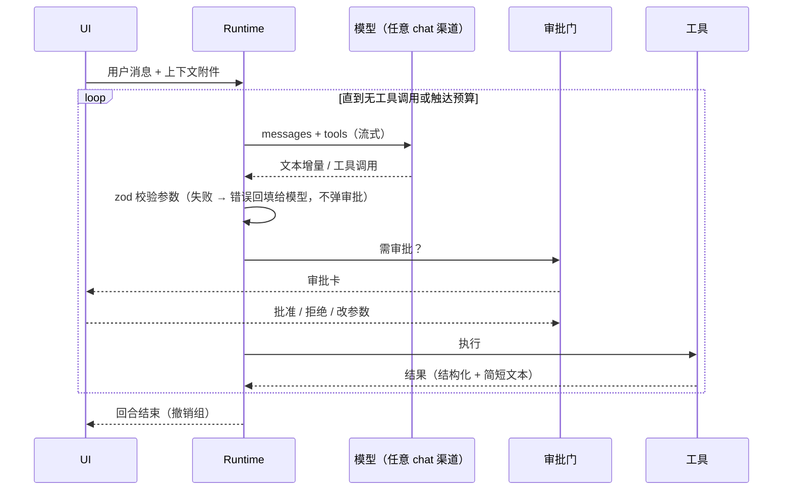

# 06 · Agent 规格

> 一个运行时，三个 Agent：首页 Agent、画布 Agent、舞台 Agent。外部 Agent（Codex / Claude CLI）复用同一套工具注册表，经 MCP 暴露。

> 状态边界：三处Agent共享组件和默认选择接线已写入；当前类型检查与全量233文件2306测试通过，但完整浏览器流程仍未验收。前端和本会话Opus调度继续暂停；不能把单测通过或应用层能力当成新界面/真实供应商全部通过。

## 1. 现状问题

| 问题 | 证据 |
|---|---|
| 运行时 1507 行 + 控制器 1070 行 + 审批 44KB，依赖 `@openai/agents` 再套一层多协议编解码 | `agent/infrastructure/sdkRuntime.ts`、`agentProviderCodec.ts` |
| 工具用泛化 `input: object`，模型猜字段 | LRN-20260813-001 |
| 额度/限流错误被错标到当前模型；连点产生重复回合 | LRN-20260814-001/002 |
| 只有画布 Agent；首页、导演台没有 | `agent/` 目录 |

## 2. 运行时（保留 `@openai/agents`，凭证据再评估替换）

当前决策：复用现有 SDK Runner、流式适配、审批恢复和供应商编解码，不以代码行数为由另建运行循环。先让 home / canvas / stage 三种作用域共用该运行时并完成真实工具流程；只有兼容性、正确性或可维护性测试提供明确反例后，再单独评估替换。下面是应用拥有的执行契约，而不是移除 SDK 的实施指令。



- 协议：OpenAI Chat Completions、OpenAI Responses、Anthropic Messages、Gemini；由 02 的 `chat` 操作提供，运行时只见归一化后的 `{text, toolCalls}`。
- 模型能力检查：渠道模型需声明支持工具调用，否则 Agent 入口提示更换模型。
- 单回合门：同一会话同时只有一个运行中回合；发送按钮在回合中变为「停止」。
- 预算：每回合最多 96 次工具调用、最长 30 分钟（包括审批等待）；到顶时停下并说明，保留已完成结果供下一回合检查后续接。
- 错误归因：错误带渠道 + 模型 + 操作三元组，展示时不猜测。
- 会话持久化：沿用 `agentSessionRepository` 的受保护存储与配额降级策略。会话持久化 `scope` 和审批模式；旧会话无 `scope` 时按 canvas 读取，不迁移或串用到首页/舞台。消息只持久化安全文本及稳定媒体引用，不存临时媒体正文。
- 全局默认值由设置 Store 的 `agentDefaults: { modelId: string | null, executionMode: 'manual' | 'auto' }` 持久化，`setAgentDefaults(patch)` 严格校验。旧/损坏配置的模型归 null、模式归 manual，不能因迁移而自动执行。`resolveAgentDefaults(overrides?)` 仅补未提供字段；显式 `modelId: null` 保持 null，不选第一个可用渠道。
- 新回合的模型与模式优先级均为「本次显式选择 > 当前已保存会话选择 > 全局默认值」；设置默认值不覆盖已有会话或本轮显式选择。模型必须仍能在真实聊天模型目录中解析，缺失、已删除或不可用时明确要求选择，不静默换模型/渠道；图片输入仍需所选模型支持视觉。默认 `auto` 也不豁免 paid/destructive 的确认。此处聊天/审批默认与 `generationPreferences` 指定的图片/视频生成目标是两套配置，不互相代填。

## 3. 工具注册表

```ts
interface ToolDef<I, O> {
  name: string;                       // 'canvas.node.create'
  surface: ('home' | 'canvas' | 'stage')[];
  description: string;                // 一句话 + 何时使用
  input: ZodType<I>;                  // 严格 schema，发给模型的 JSON Schema 由它生成
  risk: 'read' | 'edit' | 'paid' | 'destructive';
  run(input: I, ctx: ToolContext): Promise<O>;
  summarize(input: I): string;        // 审批卡上的一行人话
}
```

- 工具直接调用各模块的应用层命令（画布命令、舞台命令、生成执行器），与现有调用者复用同一校验、事务与权限边界；应用层已开放的能力可先被 Agent 使用，不声称待接线／未验收的视觉控件已经交付。
- 读工具返回精简视图（节点 id、类型、标题、提示词摘要、尺寸、连线），不返回图片数据；需要看图时调用 `asset.view`，以缩略图喂给视觉模型。

## 4. 三个 Agent

| | 首页 Agent | 画布 Agent | 舞台 Agent |
|---|---|---|---|
| 位置 | 首页主输入框「Agent 模式」+ 会话页 | 画布右侧栏（可拖宽，可收起） | 舞台底部输入框 + 右侧会话抽屉 |
| 典型任务 | 从一句想法到剧本/分镜清单；在工作台直接出图；建项目并铺好画布；配置渠道（02 §5.2） | 按剧本批量建分镜节点并连线；批量改提示词；整组提交生成；整理布局 | 读图/文字建场景；按描述摆人物与机位；画轨迹与机位运动；检查构图 |
| 工具 | `project_list/create/open`、`asset_search/view`、`home_generation_submit/status`、`canvas_prepare_plan/open_plan` | 现有完整 `canvas_command`、`diagnostics`、`config_patch`、`asset_read`，由原命令注册表校验 | `stage_query/create/open/command/direct`、`stage_draft_scene`、`stage_capture/record`、`asset_view`；direct 编译故事计划，command 精确覆盖物体、相机、轨迹、片段、关键帧与草案采纳 |
| 差异点 | 首页一句话即可产出「一份画布方案」，预览后一键在画布展开 | 应用层按回合标记图变更，满足安全边界时可一次撤回整回合 | `stage_capture` 返回真实离屏渲染资产；经获批 `asset_view` 后，模型才有构图观察依据 |

## 5. 上下文与输入

- 画布选中节点自动以灰色附件出现在输入框上方；取消选中消失；点一下固化为正式附件。
- `@` 引用节点/资产/舞台对象；`/` 唤起 skills。
- Skills：带 frontmatter 的 Markdown（`name`、`description`、`surface`、`tools` 白名单），内置 + 用户自建；「组 → 创建为 skill」把组内节点结构与提示词模板化。
- 用户技能由 `userSkills.ts` 的 `useAgentSkillStore` 写入工作区文档（IndexedDB），存储降级通过 `storageStatus` 明示。Markdown 仅接受上述四个元数据字段；`surface` 为 `home/canvas/stage/all`，`tools` 必须使用已注册的工具名，正文为 instructions。内置技能不可修改，组转换只返回草稿，确认后才保存。
- `/` 列表使用 `listSkillsForSurface(surface)`，回合以 `explicitSkillIds` 传递选择；自动路由按作用域过滤，显式选择不会被三技能自动路由预算丢弃。多个用户技能的工具白名单取交集，只限制现有工具，不授予额外命名空间、跨作用域权限或审批豁免。SDK 和外部 Agent 都在工具暴露及执行/审批边界校验限制。
- 画布提示词编辑请求本身属于画布编排信号（含“提示词”或 `prompt`），不要求用户在“把提示词都改成某种风格并生成”等自然请求中重复节点类型；问候等无领域信号的输入仍保持最小工具集。工具暴露不等于付费/破坏性审批获准。
- `@` 列表使用 `listAgentMentionCandidates({scope,projectId?})`，插入候选的稳定 `token`；`resolveAgentMentions(text,candidates)` 异步返回图片 `media` 和带真实 id 的 `contextLines`。重名不按裸标签猜对象；图片通过现有媒体解析链读取持久来源，不发送原始 `blob:` URL；组草稿和候选不会自动提交生成。

## 6. 审批与撤销

- 模式：手动 / 自动。手动：普通只读操作自动读取，编辑以上出审批卡；图片发给视觉模型需要确认。自动：非付费、非破坏性操作可自动继续；`paid` 与 `destructive` 必须明确确认，不因使用 SDK 或外部 CLI 而绕过。已批准生成的原任务状态查询不重复提交付费请求。
- 审批卡：一行人话摘要 + 展开看参数 + 预计费用（渠道有价格时）+ 「批准 / 拒绝 / 改参数」；**悬停审批卡时画布上高亮受影响节点**。
- 同一回合的多个同类操作合并成一张卡（「创建 6 个图片节点并连线」）。
- “撤回本回合”针对画布图历史，不撤销供应商付费任务、生成历史库、知识库或其他外部副作用；消息卡片入口仍是视觉规格。`rollbackAgentTurn({projectId,runId})` 先在内存倒序准备全部还原，再一次发布图与历史，不暴露逐条撤回的中间状态。
- 回合归属使用稳定 `agentTurnId`，与只合并相邻图编辑的 `groupId` 分开：生成提交会关闭普通撤销组，但提交占位节点、生成中的异步文本/元数据写入、结果轮询与已有任务结果物化仍继承发起回合的归属。异步等待前捕获归属并显式传递，生成结果节点的 `generationAgentTurnId` 支持后续轮询恢复；保留的历史归属随项目保存/重开，不依赖某个 Agent 面板一直挂载，也不把等待期间手动编辑归给 Agent。
- 安全屏障保持严格：只能撤回当前项目、当前保留历史中该回合首次变更至栈顶完全归该回合所有的连续后缀。中途或之后出现手动编辑/其他回合编辑即返回 `not-latest`，即使其后又有本回合生成轮询写入也不穿透屏障；没有保留变更为 `no-changes`，项目不符为 `project-changed`。历史仍受画布步数/字节与持久化保留上限约束，不承诺恢复已淘汰条目。普通逐步撤销的分组边界不因此改变。

## 7. 外部 Agent

外部 CLI（Codex / Claude Code）经内置 MCP 服务器访问**同一工具注册表**，按 surface 暴露；风险等级与审批规则一致（外部 Agent 的 `paid`/`destructive` 调用同样在应用内弹审批卡）。连接流程与故障细节见 ComfyUI/外部 Agent 审计结论后的补充章节。

## 8. 验收

- 首页：「做一个 6 镜头的猫咪短片分镜」→ 产出画布方案 → 展开为 6 个图片节点 + 剧本文本节点并连线。
- 画布：选中组 →「把提示词都改成赛博朋克风格并生成」→ 审批卡合并为两张（改提示词、提交生成）→ 撤回本回合恢复原状。
- 舞台：上传街景图 →「两个人在路口相遇，机位跟拍左边的人」→ 场景草案 + 两个人物 + 轨迹 + 跟随机位，播放可见。
- 工具参数校验失败不弹审批卡，模型在下一步自我修正。

## 9. 当前应用层接入

- `getScopedAgentSession({scope, projectId?})` 位于 `src/features/agents/application/scopedAgentSession.ts`，按作用域和项目持有应用生命周期内的稳定实例。首页可省略 projectId（独立首页会话）；画布/舞台必须传真实项目 id。`createScopedAgentSession` 保留给测试或需要独立实例的调用者。首页导航离开只取消订阅，不调用 stop；回到首页继续呈现同一回合和待审批项。仅首次空闲实例可加载历史，不要在重挂载时用历史覆盖正在运行或等待审批的快照。
- UI 可使用 `useSyncExternalStore(service.subscribe, service.getSnapshot)`；快照提供历史消息、文本增量、reasoning summary、工具事件、审批、状态和错误。准确发送输入为 `send({message,model?,executionMode?,explicitSkillIds?,media?,generationPreferences?})`，省略模型/模式时按 §2 解析；审批续跑为 `resolveApproval({approvalId,approve,model})`，历史操作为 `listSessions()`、`loadSession(id)`、`newSession()`。运行或等待审批时均不允许另开回合/替换历史。
- `stop()` 先 abort 当前本地调用信号并撤销未执行审批；SDK 审批恢复使用当前调用与回合信号组合，经命令注册表传到 `node.media.edit` 和舞台 capture 等支持取消的服务。外部 Agent stop 同样先 abort 本回合本地执行，再等原生 CLI 取消确认；原生确认迟到/失败不能让已停的本地媒体继续提交图。不可物理中断 API 的迟到结果按各应用服务释放，不把停止伪称为已取消上游付费生成或退款。媒体具体取消/源与历史不变契约见 03 §4.5。
- 首页 `canvas_prepare_plan` 将完整剧本/镜头提示词保存在独立工作区文档，返回绑定当前首页回合的 `planId` 与预览元数据；`canvas_open_plan({projectId,planId})` 读取原文并一次创建剧本文本、全部镜头图节点和连线，不从脱敏审计内容重建长文本，也不自动生成图片。生成使用工作台真实任务，状态只返回稳定资产引用。
- 舞台 capture 的挂载、精确时间、四视图、renderer 确认和过期结果拒绝统一遵守 05 §7；此服务边界不代表新增截图控件已经完成。`asset_view` 在获批后才把捕获资产交给视觉模型，未成功查看不能声称检查过构图。
- 外部 CLI 的 `processExternalAgentToolRequest({projectId,request,executionMode})` 与 SDK 使用同一风险策略；返回 `result` 时已执行安全调用，否则 UI 显示返回的 `approval`。原有仅手动外部入口保持兼容。
- 待审批列表按会话所属 scope 隔离：项目级查询默认 canvas；传 sessionId 时从所属会话推导 scope。自动只读续跑复用已持久化审批及其原始参数指纹，展示脱敏内容不得重新生成审批指纹。舞台 capture 工具将画布资产 id 转为资产库可解析的稳定引用后交给 `asset_view`。
- 三作用域共用 `kb_search/read/write/organize`：读笔记按 UTF-16 字符 `offset/limit` 分页（最多 4000 字符），返回 `nextOffset`；初始化不打开目录选择器，未设置知识库返回 `VAULT_UNSET`。`kb_write` 为 destructive（不属于画布撤销）；`kb_organize` 为 paid + 外部副作用，只用本轮用户所选模型，最多 20 篇 / 120000 字符，不注入渠道未声明的参数，也不自动重试付费提交。笔记工具仅返回安全分页/写入回执，不把完整整理正文复制进会话。
- 首页渠道工具：`channel_list/models/preview` 为 read；`channel_generate_profile` 为 paid，只用本轮用户所选模型编译粘贴文档；`channel_create/update` 为 edit，但自动模式仍要求明确批准。预览复用设置页的 `previewChannel` 渲染路径，校验错误原样返回；完整配置和请求预览以 `profileJsonChunks/requestPreviewChunks` 返回，拼接后可获得原文。工具不接收凭据，创建仅保存 profile，更新保留独立凭据，用户必须在设置中输入 Key。
- 审批恢复保留原始技能路由、工具白名单及模型引用；恢复时白名单只收窄不放宽，原本轮模型不可用则要求新开回合，不改用默认模型。
- 同一次模型响应的多个独立画布编辑可依次审批：只有前一项成功、实际图变化完全限于其声明影响资源、下一项影响资源不重叠且重新校验不扩大范围时，才更新同批待审批项的基准修订。其他节点/连线的用户编辑、重叠资源、付费提交或失败执行不会得到此更新，仍保留严格过期修订检查。

### 9.1 舞台导演工具

- `stage_command` 支持同一个 `command` 字段中的单命令或 1–100 条命令数组；数组整体使用同一修订与撤销事务，任一破坏性命令使整批升级审批。物体参考图字段仍不能经 Agent 补丁写入。
- `stage_query({nodeId:null})` 返回活动舞台、真实对象/修订与场景、姿势、动作（含米/秒速度）、机位目录及解剖通道。不得虚构 id。
- `stage_direct` 工具输入（所有对象 strict）：`{nodeId:string,plan:StoryPlan,dryRun:boolean,expectedRevision?:number}`。dryRun 返回 `{nodeId,revision,dryRun:true,commands,warnings,durationSeconds,captureTimes}`；执行返回真实舞台精简快照、createdIds、warnings、captureTimes。计划完整字段及编译规则见 05 §9。
- dryRun 风险为 read；真实执行逐一检查编译命令的 `stageCommandEffects`，包含轨迹/动作/区间替换或删除即 destructive，否则 edit。仍走 SDK 与外部 Agent 共用审批门，不绕过自动模式下 destructive 的明确确认。
- 固定工作流：query 目录 → 写 plan → `stage_direct(dryRun:true)` 检查警告 → 用返回 revision 作为 expectedRevision 执行 → 按 captureTimes 调 `stage_capture({nodeId,timeSeconds})` → 获批 `asset_view` 看真实画面 → 针对观察修正、重新预览。预览和执行共用同一编译器；执行不分块，一次图事务、一步撤销。过期修订拒绝，不为越过修订检查自动重试。
- `stage_capture` 是 edit 工具，严格 JSON 输入为 `{ nodeId: string, timeSeconds?: number, view?: 'current' | 'four' }`；timeSeconds 为有限的 0–120 秒且还须在舞台实际总时长内。省略 view 等同 current：无时间用真实当前挂载视角，有时间必须用精确成片机位桥。four 调 `stageCommands.captureFourViews(nodeId,timeSeconds?,context.signal)`，四张图在同一快照/采样时间，顺序为 `front/right/back/left`；没有四视图桥不得退化为四次当前截图。
- `signal?: AbortSignal` 位于工具执行上下文，不是模型输入 JSON 字段；服务准确签名及离屏 `OutputPass`、实时状态保持、已提交 renderer 确认、异步编码后修订再检查见 05 §7。捕获未就绪/过期/取消均明确失败，不任意延时重试，不使用旧图或当前帧冒充指定时刻。
- current 成功返回 `{nodeId,assetId,timeSeconds?}`，four 返回 `{nodeId,images:[{assetId,view},…],timeSeconds?}`。每个 ID 均须能解析成真实图片资产；工具先查全局 ID，兼容旧画布资产时转换为 `project:<projectId>:<画布资产ID>` 再解析，返回资产库确认的稳定 `asset.id`，不向模型返回临时 URL 或内联图片正文。成功只表示捕获并登记，不代表模型已查看；仍须成功调用 `asset_view` 后才能声称视觉检查。

示例：先查询并把 nodeId 替换为真实舞台 id。以下新人物/布景 id 需未被场景占用；预览后检查警告，再以相同 plan、`dryRun:false` 和返回修订执行。

```json
{
  "nodeId": "stage",
  "dryRun": true,
  "plan": {
    "version": 1,
    "duration": 8,
    "cast": [
      { "kind": "new", "itemId": "alice", "presetId": "woman", "label": "Alice", "heightM": 1.7, "position": { "x": -3, "y": 0, "z": 0 } },
      { "kind": "new", "itemId": "bob", "presetId": "man", "label": "Bob", "heightM": 1.8, "position": { "x": 3, "y": 0, "z": 0 } }
    ],
    "setObjects": [
      { "itemId": "street", "presetId": "scene-street-corner", "label": "Street", "position": { "x": 0, "y": 0, "z": -4 } }
    ],
    "marks": [
      { "id": "left", "position": { "x": -0.7, "y": 0, "z": 0 } },
      { "id": "right", "position": { "x": 0.7, "y": 0, "z": 0 } }
    ],
    "beats": [
      {
        "start": 0, "duration": 4,
        "blocking": [
          { "itemId": "alice", "to": { "markId": "left" }, "actionId": "walk", "facing": { "actorId": "bob" }, "lookAt": { "actorId": "bob" } },
          { "itemId": "bob", "to": { "markId": "right" }, "actionId": "walk", "facing": { "actorId": "alice" }, "lookAt": { "actorId": "alice" } }
        ]
      },
      {
        "start": 4, "duration": 4,
        "blocking": [
          { "itemId": "alice", "actionId": "talk", "lookAt": { "actorId": "bob" } },
          { "itemId": "bob", "poseId": "stand-relaxed", "lookAt": { "actorId": "alice" } }
        ]
      }
    ],
    "shots": [
      { "start": 0, "duration": 4, "size": "wide", "angle": "eye", "movement": "track", "subjectItemIds": ["alice", "bob"], "transition": "cut", "fov": 45 },
      { "start": 4, "duration": 4, "size": "medium", "angle": "eye", "movement": "static", "subjectItemIds": ["alice"], "transition": "cut", "fov": 45 }
    ]
  }
}
```

